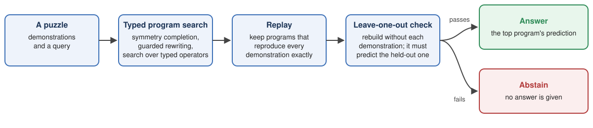
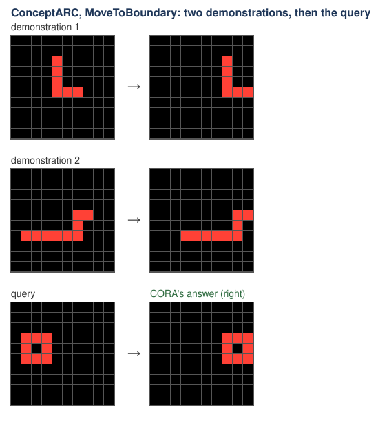

# CORA: a reasoner that answers only when it can check itself

**CORA (Constructive Operator Reasoning Architecture) writes small programs that explain a puzzle, keeps a program
only if it reproduces every example and survives a leave-one-out check, and abstains when the checks fail.**

> "Can a system learn useful representations and reasoning rules from unfamiliar data, recognize when its explanation
> is inadequate, decide what needs to change, and carry that way of reasoning into a problem with different
> semantics?"
>
> Chimdi Walter Ndubuisi, the question behind this work





*A real puzzle from ConceptARC, a public ARC-style benchmark that our development never used: CORA's answer is right.
ConceptARC (Moskvichev, Odouard and Mitchell, 2023), MIT licence.*

CORA is tested on ARC-AGI-2, a benchmark of grid puzzles: each puzzle
gives a few demonstration pairs (an input grid and its output grid) and asks for the output of a new input, the query.
Status: 2 November 2026.

## Headline numbers

| what | result | limit |
|---|---|---|
| the CORA-only Kaggle entry (submission 57902131), ARC Prize 2026 | **0.83%** on the public leaderboard | below the 5% that the ARC-AGI-2 authors treat as meaningful |
| the neural entry with CORA on attempt 2 (submission 57867631) | **24.03%** | the neural method's score: CORA changed none of its 172 public evaluation answers |
| the CORA-only entry on the similar-problem benchmarks: right answers among the outputs it answered | **295/308** (1D-ARC), **19/20** (Mini-ARC), **44/54** (ConceptARC) | it answers only 50%, 13% and 11% of the outputs |
| the same, given another puzzle's demonstrations | precision **0.000 to 0.026** | the checks depend on the evidence |
| the cell-image biology test (LIVECell, NuInsSeg, MoNuSAC), on held-out images | **no edits**: results equal the strong baseline | non-degrading only because it abstained; learned transfer was not shown |

Details, real puzzles and real cell images: **[the results page](docs/RESULTS.md)**.

## How it works

1. **Search.** CORA finds the objects in each grid and searches over typed operations on them: completing a
   symmetry, rewriting objects under guarded rules, and short programs of typed operators.
2. **Replay.** Every candidate program runs on every demonstration. Only exact reproductions survive.
3. **Leave-one-out check.** The search is repeated with each demonstration held out in turn; it must still recover
   the held-out output.
4. **Answer or abstain.** If the check passes, CORA answers with the top program's prediction. If not, it gives no
   answer of its own rather than a guess; the Kaggle entry then submits a copy of the query as a placeholder.

## Run it

- **On Kaggle:** the CORA-only entry is
  [chimdiwalter/cora-cast-r29-v2-arc-agi-2](https://www.kaggle.com/code/chimdiwalter/cora-cast-r29-v2-arc-agi-2)
  (CPU) and the neural entry is
  [chimdiwalter/sf-h-c4-cast-arc-agi-2](https://www.kaggle.com/code/chimdiwalter/sf-h-c4-cast-arc-agi-2) (GPU). To
  run either on the 120 public evaluation puzzles, add a first cell:
  `import os; os.environ['SF_REHEARSE_ON'] = 'evaluation'`.
- **Locally,** from the repository root. The builder calls the two entries `H` (the neural entry) and `OP2` (the
  CORA-only entry), and their rehearsals on the public evaluation puzzles `HRH` and `OP2RH`:

```sh
# score both entries' frozen predictions; bring your own copy of the competition's arc-agi_evaluation_solutions.json
python3 kaggle_entries/score_rehearsal.py --solutions PATH/TO/arc-agi_evaluation_solutions.json

# rebuild all four notebooks byte for byte into a new folder
python3 kaggle_entries/builder/kaggle/score_first_2026/configs/build_configs.py --kernels /tmp/rebuild --only H,HRH,OP2,OP2RH

# run the process-level tests of the CORA-only entry's time caps (pytest; about 3 minutes)
cd kaggle_entries/builder && python3 -m pytest -q -p no:cacheprovider kaggle/score_first_2026/configs/tests/test_op2_caps.py
```

Everything else, including a local CPU rerun of the CORA-only entry and every test:
[kaggle_entries/README.md](kaggle_entries/README.md).

## What's next (in progress)

None of these has a reviewed result yet.
- **Learned grammar transfer:** a frozen, learned operation library tested on similar ARC-style benchmarks at matched
  compute.
- **Failure-triggered grammar growth:** a public research notebook is coming.
- **Biology:** a Boolean-network test with a prior-knowledge condition: the published regulator wiring, against
  shuffled wiring and no wiring, checked against the true rules.
- **A better acceptance rule for noisy science data,** one that weighs prior knowledge.
- **The ARC Prize paper,** due 9 November.

## Where things are

| folder | what it is |
|---|---|
| `kaggle_entries/` | the two submitted Kaggle entries exactly as they ran, with their expected predictions, a scorer, the notebook builder and its tests |
| `docs/RESULTS.md`, `docs/img/` | the results page and its images |
| `geocat_arc/`, `cora_*/` | earlier CORA engines and experiments |
| `records/`, `docs/` | study plans, frozen protocols and results; design notes |
| `docs/research_checkpoint_20261030/`, `research/cora_synthetic_audit_20261030/` | an earlier research checkpoint (30 October 2026): automatic abstraction and bounded construction studies, and a standalone synthetic audit |
| `kaggle/`, `scripts/`, `tests/`, `src/` | earlier competition notebooks, study runners, tests and shared code |

## Credits and licences

- The neural entry re-implements NVARC's method and uses the public checkpoint of its authors, Ivan Sorokin and
  Jean-Francois Puget. No NVARC code is included.
- ARC-AGI-2 puzzles are the ARC Prize Foundation's public data (Apache 2.0). The benchmark and biology images keep
  their own licences: [docs/img/LICENSES.md](docs/img/LICENSES.md).
- Code is MIT-0 and our text is CC0 1.0; see [LICENSE](LICENSE).
- The research, design decisions, claims and authorship are Chimdi Walter Ndubuisi's. AI coding assistance was used
  for parts of the implementation and documentation.
