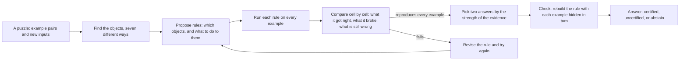

# CORA: a reasoning system that explains puzzles with rules it can run and check

**The question behind this work:** how can a machine learn how to describe new data, learn from its failures, and
know what to reconsider when its explanation is not good enough?

We study that question on **ARC-AGI-2**, a public benchmark of colourful grid puzzles. Each puzzle shows a few
example pairs (an input grid and its output grid) and asks for the output of a new input. A person usually sees the
rule quickly; machines find it hard. Every guess can be checked exactly, which makes ARC a good laboratory.

**CORA** is the system built here. It does not guess the answer grid directly. It writes an explanation as a small
program ("recolour every object that touches the border", "draw a line from each red square to the edge"), runs that
program on every example, and keeps it only if it reproduces the examples exactly. Status: 21 October 2026.

## The short version

- CORA's explanations are checkable, and its strictest check is usually right: answers it certified were correct
  6 of 6 times on 60 practice puzzles and 5 of 6 times on 40 others.
- But CORA rarely finds an explanation for new puzzles. Its score on the official hidden ARC-AGI-2 test is **0.00%**.
- Most of the progress so far is on puzzles we generated ourselves, which are easier than real ARC puzzles. Those gains
  have not yet carried over to real puzzles.
- The real failures point to one main cause: CORA describes puzzles in terms of whole objects, but many puzzles change
  only part of an object (its border, its corners, the hole inside it) or add new lines. The newest version targets
  exactly that, and is being tested now.

## Results so far

Results of different kinds are never mixed. "Generated puzzles" are puzzles we wrote with our own rule language, so
they measure engineering progress, not ARC ability. "Real public puzzles" are ARC-AGI-2 training puzzles that are
public; CORA's development has seen many of them, so they are practice evidence, not a clean test. Only the official
Kaggle leaderboard uses hidden puzzles. "Solved" means one of two allowed attempts is exactly right.

| what was tested | on what | result | what it means |
|---|---|---|---|
| the original CORA, on the official leaderboard (three entries, July to October 2026) | hidden ARC-AGI-2 puzzles | 0.00% | it does not yet solve unseen ARC puzzles |
| a published neural method by another team (NVARC), rerun unchanged for comparison; **not ours** | hidden ARC-AGI-2 puzzles | 27.64% | the reference point for neural methods |
| a trained neural guide that tells CORA's search what to try first | 395 generated puzzles | 198 solved; 104 without the guide; 358 with a hand-designed order | learning helped, but did not beat careful hand design |
| CORA's rule language, version 2 (CORA's built-in program types rewritten in one typed, checkable language) against version 1 | 200 generated puzzles | 162 vs 43 solved | a large gain on generated puzzles |
| the same two versions | 40 real public puzzles | 2 vs 1 solved (the original CORA: 4 certified) | below the 3-puzzle gain we required in advance: no real gain |
| version 3 (builds both halves of a rule, which objects and what to do with them, from where its output is wrong; picks its two answers by the strength of the evidence) against version 2 | 296 generated puzzles | 271 vs 166 solved (106 gained, 1 lost) | passed every criterion set in advance; generated puzzles only |
| version 4 (rules over parts of objects and lines drawn from objects) | code tests | 39 tests pass | built and checked, not yet evaluated |
| **running now:** version 4 on 210 new generated puzzles; then all versions, and the original CORA, on 34 real public puzzles not used in any of our earlier tests | | no results yet | the first real test of version 3 and version 4 |

Still unproven: that learning from failures beats an equal amount of plain search; that any trained model helps
inside CORA; that the approach transfers to other kinds of data, such as biological measurements.

## How it works

1. **Find objects.** A grid can be split into objects in several ways (cells of one colour touching side by side, or
   also diagonally; groups of several colours; one object per colour). CORA tries seven, because the right way
   depends on the puzzle.
2. **Propose rules.** A rule has two halves: *which objects* (for example "objects touching the border", "the largest
   object") and *what to do* (recolour, move, delete, draw a line, fill a hole). A program is a short list of rules.
3. **Run and compare.** Every candidate runs on every example. CORA records exactly which cells it fixed, which it
   broke and which are still wrong, and uses that to build the next candidates.
4. **Choose and check.** Among the rules that reproduce every example, CORA prefers the simplest and best-supported,
   and submits two different answers. An answer is **certified** only if the rule, rebuilt with each example hidden
   in turn, still predicts the hidden example. If the evidence is too thin, CORA can abstain.

The four versions of the rule language add, in order: a typed language that CORA can check before running anything
(version 1); CORA's own built-in program types in that language (version 2); building rules from where their output
is wrong (version 3); and rules over parts of objects and lines (version 4).

## Words used here

- **example (demonstration):** one input grid with its output grid, shown as part of the puzzle.
- **fits:** a rule fits when it reproduces every example exactly.
- **certified:** a fitting answer that survives being rebuilt with each example hidden in turn.
- **coverage:** the share of puzzles for which the right answer is among the answers CORA kept. A picker can never
  choose an answer that is not there, so the solved rate can never exceed coverage.
- **frozen study:** a test whose puzzles, code and pass criteria were fixed and fingerprinted before it was run once,
  so the result cannot be tuned after the fact.

## Where the code is

Folder and file names keep the project's internal labels. This table says what each one is.

| folder | what it is |
|---|---|
| `geocat_arc/` | the original CORA engine: object finding, features, relations, the rule interpreter |
| `cora_neural_v2/` | rule language version 1 (internal label ncv2-g1) |
| `cora_neural_v2g2/` | rule language version 2 (ncv2-g2) |
| `cora_neural_v2g3/` | rule language version 3 (ncv2-g3), including the answer picker and a rule-revision step |
| `cora_neural_v2g4/` | rule language version 4 (ncv2-g4): parts of objects, regions and lines |
| `cora_neural_v2g4_eval/` | the generated puzzles for version 4's test |
| `cora_neural_v1/` | the trained search guide |
| `cora_revision_v2/`, `cora_fhr/`, `cora_funnel/`, `cora_reach/` | earlier experiments: keeping every rival explanation, building missing operations from failures, failure analysis |
| `kaggle/` | the competition notebooks (CORA's own code only) |
| `records/` | every study's plan, fingerprints and results; `records/CORA_SUMMIT_CLAIM_LEDGER_20261017.md` lists every public claim and its evidence |
| `scripts/`, `tests/`, `docs/` | study runners, tests, design notes and an offline demonstration |

## Trying it

- Run the tests: `pytest tests/`.
- Replay a recorded result offline: `python docs/summit_demo_20261023/replay_real.py` (a rule CORA built for one
  real public puzzle: blue objects draw a line up-left, red ones down-right).
- Each frozen study's runner checks its fingerprints first and refuses to run without an explicit authorization flag;
  only its scoring step ever reads the expected answers.

## Credits and licences

NVARC's method and model belong to their authors; the 27.64% is their method, rerun as a baseline, and is not a CORA
result. NVARC's notebook code is not included here. ARC-AGI-2 puzzles are the ARC Prize Foundation's public data.

The research, design decisions, claims and authorship are Chimdi Walter Ndubuisi's. AI coding assistance was used for
parts of the implementation and documentation.
