# CORA on ARC-AGI-2: executable reasoning and hypothesis revision

How can a machine learn the representation of new data, learn from failure, and know what to reconsider when its
explanation is not enough? This repository studies that question on ARC-AGI-2, where a few demonstrations define each
task and every explanation can be executed and checked exactly.

**CORA** is an object-based program-synthesis system. It explains a task with an executable rule over objects, runs
the rule on every demonstration, compares rival rules, and certifies an answer only when the rule, rebuilt with each
demonstration hidden in turn, still predicts it. **Neural-CORA** is the line of work that adds typed programs, joint
rule construction and learned components inside CORA's checked search. Every study is scored by a separate
evaluator under a protocol frozen before the run. Status as of 21 October 2026.

## Status at a glance

Results are kept in separate categories and never pooled. "Exposed" means the tasks are public ARC-AGI-2 training
tasks that CORA's development has already used (and that the NVARC model saw in training), so they are development
evidence, not unseen scores.

| category | study | result |
|---|---|---|
| official Kaggle public evaluation | CORA (native engine), three entries (July, 13 Oct, 18 Oct) | 0.00% each |
| official Kaggle public evaluation | NVARC, a published Qwen3-4B test-time-training method, reproduced unchanged (not CORA) | 27.64% |
| synthetic engineering (frozen) | Neural-CORA v1: a trained guide ordering CORA's search, 395 held-out tasks | 198 vs 104 for unguided search; hand-designed search 358 (NO-GO) |
| synthetic engineering (frozen) | ncv2-g2 vs ncv2-g1, 200 held-out tasks | 162 vs 43 (GO_ENGINEERING) |
| exposed real-task development (frozen) | ncv2-g2 vs ncv2-g1, 40 public training tasks | 2 vs 1 solved; native CORA 4 certified (NO_REAL_GAIN: the bar was +3) |
| synthetic engineering (frozen) | ncv2-g3 vs ncv2-g2, 296 held-out tasks | 271 vs 166 (91.6% vs 56.1%), 106 gains, 1 loss (GO_ENGINEERING) |
| software verification | ncv2-g4 representation-aware construction | 39 unit tests pass; not yet evaluated |
| in progress | syn-v4 (ncv2-g4 synthetic study, 210 tasks) | frozen; running |
| in progress | real-task check: native CORA, ncv2-g2, ncv2-g3, ncv2-g4 on 34 fresh eligible public training tasks | frozen; queued |
| open hypotheses | failure records improve revision; a revision procedure transfers to other domains | untested |

Synthetic results come from task families written inside CORA's own grammar: they measure engineering progress, not
ARC ability. Records for every row are in `records/` (the claim ledger is
`records/CORA_SUMMIT_CLAIM_LEDGER_20261017.md`; each study has a protocol, a freeze manifest and a report).

## Architecture

```mermaid
flowchart LR
  T[ARC task: demonstrations and test inputs] --> V[Seven segmentation views: objects, features, relations]
  V --> G[Candidate rules]
  subgraph G[Candidate rules]
    N[native program classes]
    S[typed search with C+H ordering: ncv2-g2]
    J[joint selector-action construction: ncv2-g3]
    P[parts, regions and lines: ncv2-g4]
  end
  G --> E[Execute on every demonstration]
  E --> D[Execution differences: fixed, broken, remaining cells]
  D -->|fits| SEL[Evidence-aware selection of two attempts]
  D -->|fails| R[Revision: rule-based controller, benefit untested]
  R --> G
  SEL --> C[Certification: rebuild with each demonstration hidden]
  C --> A[Prediction: certified, exploratory, or abstain]
```

| component | what it does | status |
|---|---|---|
| `geocat_arc/` (native CORA) | segmentation in seven views, 36 object features, 12 relations, executable object programs with first-match rules, reduction and generative program classes, leave-one-out certification | sealed engine v23 |
| `cora_neural_v2/` (ncv2-g1) | typed relational syntax tree, compiler to native programs (native semantics for every typed program), sound constraints, pairing-aware search | tested |
| `cora_neural_v2g2/` (ncv2-g2) | native program classes as typed forms, an object-program decompiler, the completed candidate generator with the hand-designed C+H ordering | tested; frozen studies above |
| `cora_neural_v2g3/` (ncv2-g3) | per-object change groups, execution differences, joint construction of a selector and its action, combinations of complementary rules, evidence-aware selection, neural interfaces (no model trained), a rule-based revision controller | tested; frozen study above |
| `cora_neural_v2g4/` (ncv2-g4) | rules over parts of objects (border, interior, endpoints, corners, contact), regions (holes, bounding-box background) and lines from objects; parameter inversion; selectors induced with objects that may or may not be picked, each confirmed by native execution; programs built as covers of the changed cells | tested; study frozen and running |
| `cora_revision_v2/` | a version space over segmentation, geometry and colour policy that detects ambiguity and thin evidence, and abstains | frozen study: NO-GO |
| `cora_fhr/` | failure-conditioned construction of a missing growth operator, installed reversibly and certified by leave-one-out | frozen study: no new certified solutions on 58 tasks |
| `cora_neural_v1/` | the first learned guide over frozen Qwen3-4B encoder features | frozen study: NO-GO |

**What the evidence shows so far.** Certification is precise on development tasks (6 accepted answers, all correct).
A rule can be constructed from failure evidence and certified on a real task, but a constructor that ignored the
failure record found the same rule, so the value of failure records is not established. Synthetic gains inside the
designed grammar have not yet carried over to real tasks. A descriptive analysis of the real failures points at
representation: which objects change is usually describable, but the changes often touch parts of objects or add
line-like cells, which is what ncv2-g4 addresses.

## Glossary

- **ARC-AGI-2:** the second Abstraction and Reasoning Corpus; each task gives a few input-output grid pairs
  (demonstrations) and asks for the output of one or more new test inputs.
- **view:** one of seven ways to split a grid into objects (same-colour or multicolour, 4- or 8-connected, one object
  per colour, and others).
- **fit:** a program that reproduces every demonstration exactly.
- **certified / exploratory:** an answer whose program, rebuilt with each demonstration hidden in turn, still
  predicts it / a fitting answer that does not pass that check.
- **coverage:** the share of tasks whose correct output is among the candidate predictions kept by the search.
- **pass@2:** the share of tasks for which one of two submitted attempts is exactly correct (every test output).
- **C+H:** the hand-designed symbolic order in which candidate programs are tried; the strong control for learned
  guides.
- **ncv2-g1 to ncv2-g4:** successive grammars of typed Neural-CORA (g1 typed syntax; g2 native capability recovery;
  g3 joint construction and selection; g4 representation-aware construction).
- **syn-v3, syn-v4:** the frozen held-out synthetic studies of ncv2-g3 and ncv2-g4.
- **frozen protocol:** a study whose tasks, code, gates and decision labels are hashed before it is run once.

## Map

| path | contents |
|---|---|
| `geocat_arc/` | the native CORA engine |
| `cora_neural_v2/`, `cora_neural_v2g2/`, `cora_neural_v2g3/`, `cora_neural_v2g4/` | typed Neural-CORA, grammars g1 to g4 |
| `cora_neural_v2g4_eval/` | the syn-v4 task generator |
| `cora_neural_v1/`, `cora_revision_v2/`, `cora_fhr/`, `cora_funnel/`, `cora_reach/` | earlier systems and their studies |
| `scripts/` | study runners (each refuses to solve without its frozen manifest and an explicit authorization flag), figure and build scripts |
| `kaggle/` | competition notebooks and scaffolds (CORA-owned code only) |
| `records/` | protocols, freeze manifests, reports, audits, the claim ledger and the stage ledger |
| `docs/` | design proposals and specifications; `docs/summit_demo_20261023/` holds offline replays of recorded runs |
| `tests/` | the test suites, e.g. `pytest tests/test_neural_cora_v2g4.py` |

## Reproducing

- Tests: `pytest tests/` (the typed-language parity tests check every compiled program against native execution).
- Frozen studies: `python scripts/<study>_eval.py lockcheck` verifies the hashed code, tasks and protocol; the solve
  stage runs only with `--authorized`, and only the score stage reads expected outputs.
- Demo: `python docs/summit_demo_20261023/replay_real.py` replays the recorded construction of a guarded rule on one
  public training task, offline.

## Attribution and licences

NVARC's method and model belong to their authors; the 27.64% is their method, reproduced as a baseline, and is not a
CORA result. NVARC notebook copies are not part of this public tree. ARC-AGI-2 tasks are from the ARC Prize
Foundation's public data.

The research, design decisions, claims and authorship are Chimdi Walter Ndubuisi's. AI coding assistance was used for
parts of the implementation and documentation.
