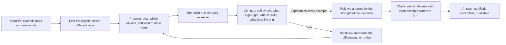

# CORA: a reasoning system that explains puzzles with rules it can run and check

**The question behind this work:** how can a machine learn how to describe new data, learn from its failures, and
know what to reconsider when its explanation is not good enough?

We study that question on **ARC-AGI-2**, a public benchmark of colourful grid puzzles. Each puzzle shows a few
example pairs (an input grid and its output grid) and asks for the output of a new input. A person usually sees the
rule quickly; machines find it hard. Every guess can be checked exactly, which makes ARC a good laboratory.

**CORA** is the system built here. It does not guess the answer grid directly. It writes an explanation as a small
program ("recolour every object that touches the border", "draw a line from each red square to the edge"), runs that
program on every example, and keeps it only if it reproduces the examples exactly. Status: 26 October 2026.

## The short version

- CORA's explanations are checkable, and its strictest check is usually right: answers it certified were correct
  6 of 6 times on 60 practice puzzles, 5 of 6 times on 40 others, and 3 of 3 on 34 more.
- Each new version of its rule language made a large, measured gain on puzzles we generated (see the table).
- None of those gains has yet carried over to real puzzles: on the official hidden ARC-AGI-2 test CORA scores
  **0.00%**, and on the 120 public evaluation puzzles every CORA-only configuration we tried solved 0, including the
  newest version of the rule language.
- The real failures point to the cause: CORA describes puzzles in terms of whole objects, while many puzzles change
  only part of an object or need operations its language does not have. Adding hand-written operations, five times
  now, has not closed that gap, so the work now tests whether a language model can write the missing programs.

## What is new here, and what is not

Not new: checking candidate programs by running them, refining a guess after a failure, and guiding program search
with a neural network are all established ideas (for example DreamCoder, LILO, Popper, SOAR and ARCANA). What this
work adds, each one measured:

1. **Rules built from what went wrong.** CORA compares a candidate's output with each example cell by cell (cells it
   fixed, cells it broke, cells still wrong) and builds both halves of a rule, which objects and what to do with them,
   together from those differences (rule language version 3).
2. **Rules over parts of objects.** Borders, interiors, corners, endpoints, holes, the background inside an object's
   box, and lines drawn from objects. The objects a rule should pick are found from the evidence, allowing objects
   on which the rule would change nothing, and every choice is confirmed by CORA's own interpreter; programs are
   assembled to cover exactly the cells that change (version 4).
3. **A precise frame for "what to reconsider".** Failures are described at separate levels (the description of the
   puzzle, the rule, the evidence, the search effort, the confidence), and the question of whether a policy for
   choosing among them transfers to other kinds of data is stated as a test at equal compute.
4. **Evidence that cannot be tuned after the fact.** Every result comes from a study whose puzzles, code and pass
   criteria were fixed and fingerprinted before it ran once, at matched budgets, and the negative results are kept.

## Results so far

Results of different kinds are never mixed. "Generated puzzles" are puzzles we wrote with our own rule language, so
they measure engineering progress, not ARC ability. "Real public puzzles" are ARC-AGI-2 training puzzles; CORA's
development has seen many of them, so they are practice evidence, not a clean test. Only the official Kaggle
leaderboard uses hidden puzzles. "Solved" means one of two allowed attempts is exactly right.

| what was tested | on what | result | what it means |
|---|---|---|---|
| the original CORA, on the official leaderboard (three entries, July to October 2026) | hidden ARC-AGI-2 puzzles | 0.00% | it does not yet solve unseen ARC puzzles |
| a published neural method by another team (NVARC), rerun unchanged for comparison; **not ours** | hidden ARC-AGI-2 puzzles | 27.64% | the reference point for neural methods |
| a trained neural guide that tells CORA's search what to try first | 395 generated puzzles | 198 solved; 104 without the guide; 358 with a hand-designed order | learning helped, but did not beat careful hand design |
| rule language version 2 (CORA's built-in program types in one typed, checkable language) against version 1 | 200 generated puzzles | 162 vs 43 solved | a large gain on generated puzzles |
| the same two versions | 40 real public puzzles | 2 vs 1 solved (the original CORA: 4 certified) | below the 3-puzzle gain we required in advance |
| version 3 (rules built from what went wrong; answers chosen by the strength of the evidence) against version 2 | 296 generated puzzles | 271 vs 166 solved (106 gained, 1 lost) | passed every criterion set in advance |
| version 4 (rules over parts of objects and lines) against version 3 | 110 generated target puzzles | 97% vs 15% solved (across all 210 generated puzzles: 104 gained, 0 lost) | passed every criterion set in advance; the puzzles are written in version 4's own language |
| versions 2, 3 and 4, and the original CORA | 34 real public puzzles not used in earlier tests | 1, 3 and 3 solved; the original CORA 3 (all certified) | no gain beyond the original CORA on real puzzles |
| version 5 (copies of a pattern at anchor points; lines that stop at, turn at or recolour obstacles; segments between objects; fills defined by relations) against version 4 | 40 generated target puzzles | 40 vs 20 solved (20 gained, 0 lost); version 4 found none of the 20 even with ten times the search | the new operations work where they apply; the puzzles are written in version 5's own language |
| the CORA-only competition notebook, every configuration, including version 5 | 120 public evaluation puzzles | 0 solved (on one puzzle, 64 version 5 programs reproduced the examples and none was right on the new input) | the next problem to solve |
| skipping candidates that earlier failures already rule out (the idea behind Popper), on and off at the same candidate budget | 170 generated puzzles | the first correct candidate came earlier on 53 of 127 puzzles and never later; 0 correct programs lost; no CPU saving | sound, but no speed-up: checking costs about as much as running the skipped candidates |
| Popper, an established system that learns logic programs from failures, on the puzzles it can encode | 5 real public puzzles; 24 and 59 generated puzzles | Popper 1, 9 and 25 solved; CORA 3, 15 and 54 | a description, not a matched test: budgets differ and Popper gives one answer where CORA gives two |

Still unproven: that learning from failures beats an equal amount of plain search; that any trained model helps
inside CORA; that the approach transfers to other kinds of data, such as biological measurements.

Being tested now: whether a public pretrained language model that writes CORA programs finds correct programs that
CORA's own search misses, and whether CORA's cell-by-cell feedback on where a program fails helps the model fix it
better than plain retries at the same cost. No result yet.

## How it works

1. **Find objects.** A grid can be split into objects in several ways (cells of one colour touching side by side, or
   also diagonally; groups of several colours; one object per colour). CORA tries seven, because the right way
   depends on the puzzle.
2. **Propose rules.** A rule has two halves: *which objects* (for example "objects touching the border", "the largest
   object") and *what to do* (recolour, move, delete, draw a line, fill a hole). A program is a short list of rules.
3. **Run and compare.** Every candidate runs on every example. CORA records exactly which cells it fixed, which it
   broke and which are still wrong, and builds the next candidates from that.
4. **Choose and check.** Among the rules that reproduce every example, CORA prefers the simplest and best-supported,
   and submits two different answers. An answer is **certified** only if the rule, rebuilt with each example hidden
   in turn, still predicts the hidden example. If the evidence is too thin, CORA can abstain.

The five versions of the rule language add, in order: a typed language that CORA can check before running anything
(version 1); CORA's own built-in program types in that language (version 2); building rules from where their output
is wrong (version 3); rules over parts of objects and lines (version 4); and copies of a pattern at anchor points,
lines that react to obstacles, segments between objects and fills defined by relations (version 5).

## Words used here

- **example (demonstration):** one input grid with its output grid, shown as part of the puzzle.
- **fits:** a rule fits when it reproduces every example exactly.
- **certified:** a fitting answer that survives being rebuilt with each example hidden in turn.
- **coverage:** the share of puzzles for which the right answer is among the answers CORA kept. A picker can never
  choose an answer that is not there, so the solved rate can never exceed coverage.
- **frozen study:** a test whose puzzles, code and pass criteria were fixed and fingerprinted before it was run once,
  so the result cannot be tuned after the fact.

## Where the code is

Folder and file names keep the project's internal labels. This table says what each one is.

| folder | what it is |
|---|---|
| `geocat_arc/` | the original CORA engine: object finding, features, relations, the rule interpreter |
| `cora_neural_v2/` | rule language version 1 (internal label ncv2-g1) |
| `cora_neural_v2g2/` | rule language version 2 (ncv2-g2) |
| `cora_neural_v2g3/` | rule language version 3 (ncv2-g3), including the answer picker and a rule-revision step |
| `cora_neural_v2g4/` | rule language version 4 (ncv2-g4): parts of objects, regions and lines |
| `cora_neural_v2g4_eval/` | the generated puzzles for version 4's test |
| `cora_neural_v2g5/` | rule language version 5 (ncv2-g5): pattern copies, obstacle-aware lines, segments, relational fills |
| `cora_neural_prune/` | skipping candidates that earlier failures already rule out |
| `baselines/popper/` | the comparison with Popper (Popper itself is installed separately) |
| `cora_neural_v1/` | the trained search guide |
| `cora_revision_v2/`, `cora_fhr/`, `cora_funnel/`, `cora_reach/` | earlier experiments: keeping every rival explanation, building missing operations from failures, failure analysis |
| `kaggle/` | the competition notebooks (CORA's own code only) |
| `records/` | every study's plan, fingerprints and results; `records/CORA_SUMMIT_CLAIM_LEDGER_20261017.md` lists every public claim and its evidence |
| `scripts/`, `tests/`, `docs/` | study runners, tests, design notes and an offline demonstration |

## Trying it

- Run the tests: `pytest tests/`.
- Replay a recorded result offline: `python docs/summit_demo_20261023/replay_real.py` (a rule CORA built for one
  real public puzzle: blue objects draw a line up-left, red ones down-right).
- Each frozen study's runner checks its fingerprints first and refuses to run without an explicit authorization flag;
  only its scoring step ever reads the expected answers.

## Credits and licences

NVARC's method and model belong to their authors; the 27.64% is their method, rerun as a baseline, and is not a CORA
result. NVARC's notebook code is not included here. ARC-AGI-2 puzzles are the ARC Prize Foundation's public data.
Popper (Cropper and Morel; MIT licence) is used as an external baseline and is not included here.

The research, design decisions, claims and authorship are Chimdi Walter Ndubuisi's. AI coding assistance was used for
parts of the implementation and documentation.
