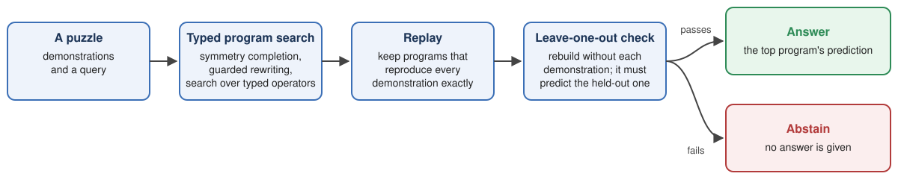
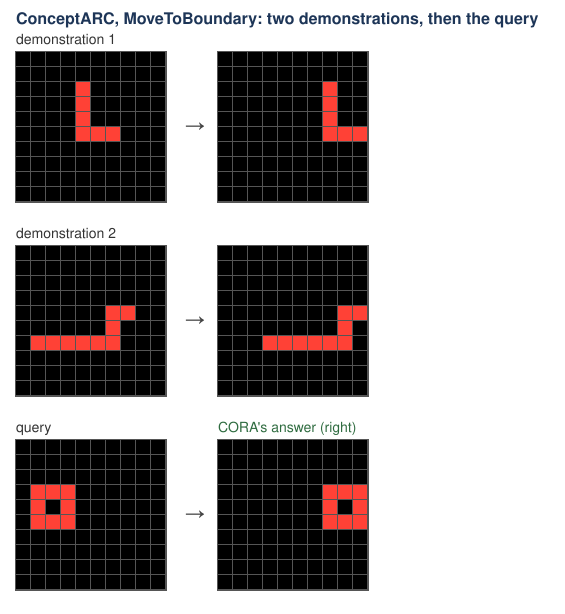
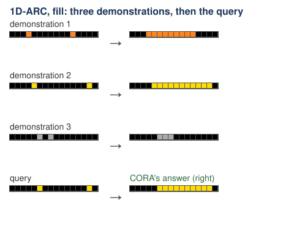
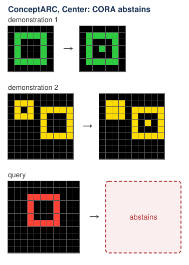
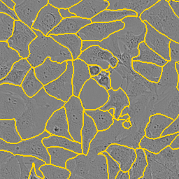
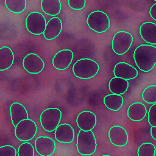
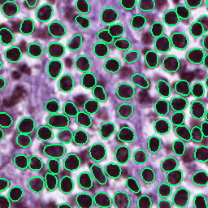

# CORA: results at a glance

Status: 2 November 2026. This page shows reviewed headline results only. Each number is given with its limit.

## 1. What CORA is

CORA (Constructive Operator Reasoning Architecture) solves a puzzle by writing a small program that explains it. It
searches over typed operations on objects, runs each candidate exactly, and keeps only programs that reproduce every
demonstration. Before answering, it repeats the search with each demonstration held out in turn and checks that it
still recovers the held-out output (a leave-one-out check). If that check fails, CORA abstains instead of guessing.

## 2. The two Kaggle entries (ARC Prize 2026, ARC-AGI-2)

ARC-AGI-2 is a benchmark of grid puzzles: each gives a few demonstration pairs and asks for the output of a new
input.

| entry | what it runs | public leaderboard |
|---|---|---|
| **the CORA-only entry** (submission 57902131) | CORA only, on CPU | **0.83%** |
| **the neural entry with CORA on attempt 2** (submission 57867631) | NVARC's Qwen3-4B method by Ivan Sorokin and Jean-Francois Puget, which we re-implemented with their public checkpoint; CORA may change only the second attempt | **24.03%** |

- The neural entry's score belongs to the neural method. On the 172 public evaluation outputs, CORA changed none of
  its answers.
- The ARC-AGI-2 authors write that "ARC-AGI-2 accuracies below 5% are generally not treated as meaningful, as they
  likely result from noise-level heuristics" ([Chollet et al., 2025](https://arxiv.org/abs/2505.11831), section 6).
  So 0.83% says little by itself.

## 3. The similar-problem benchmarks: 1D-ARC, Mini-ARC and ConceptARC

These are three public ARC-style benchmarks that our development never used; none shares an input and output pair
with ARC-AGI-2. Here *precision* means right answers among the outputs CORA answered, and *coverage* means the share
of outputs it answered at all.

| benchmark | precision of the CORA-only entry | coverage |
|---|---|---|
| 1D-ARC | 295 / 308 | 50% |
| Mini-ARC | 19 / 20 | 13% |
| ConceptARC | 44 / 54 | 11% |

- **The check depends on the evidence.** Given another puzzle's demonstrations, precision collapses to 0.000 to 0.026.
- **Strictness buys precision at the cost of coverage.** Pooled over the three benchmarks, the strict acceptance rule
  of the neural entry's CORA step was right on 71 of 82 answers. Accepting any program that fits every demonstration
  was right on 102 of 134. Coverage fell from 10.8% to 6.6%.
- **Limits.** On 1D-ARC, most right answers (244 of 295) came from the CORA-only entry's second CORA package. That
  entry answered 28.8% of all outputs correctly, but it ran with a larger budget than the controls, so that figure is
  descriptive, not a compute-matched comparison.

*ConceptARC, MoveToBoundary: CORA's answer is right. ConceptARC (Moskvichev, Odouard and Mitchell, 2023), MIT
licence.*

*1D-ARC, fill: CORA's answer is right. 1D-ARC (Xu et al., 2023), MIT licence.*

*ConceptARC, Center: no program passed the checks, so CORA abstains. ConceptARC, MIT licence.*

## 4. The cell-image biology test: LIVECell, NuInsSeg and MoNuSAC

The same frozen procedure ran unchanged on held-out data from three public image datasets: phase-contrast cells, and
H&E-stained (haematoxylin and eosin) nuclei from 31 organs and from 67 patients in The Cancer Genome Atlas. It was
set to correct a strong segmentation baseline.
- **Strict CORA made no edits** on the held-out images, so its results equal the baseline. It was non-degrading only
  because it abstained, not because it found verified gains.
- **Learned transfer was not shown.** The rule set learned on the first dataset was empty, so nothing learned was
  carried to the other two.
- **A matched static search over the same operations** gave a descriptive gain on MoNuSAC: +0.0116 in mean F1 per
  patient, where F1 balances missed and spurious cells (95% interval +0.0066 to +0.0169; 33 of 40 patients better).
  It is a descriptive contrast with no pre-declared significance test, and the gain is the search's, not CORA's.

*Held-out crops with the baseline's outlines, unchanged by CORA. From left: LIVECell (Edlund et al., 2021), CC BY-NC
4.0; NuInsSeg (Mahbod et al., 2024), CC BY 4.0; MoNuSAC 2020 (Verma et al., 2021), CC BY-NC-SA 4.0. The two
images under NC (non-commercial) licences are for non-commercial use only. Sources and licences:
[img/LICENSES.md](img/LICENSES.md).*

## 5. Next

Tests of learned grammar transfer are in progress, and a paper follows.
