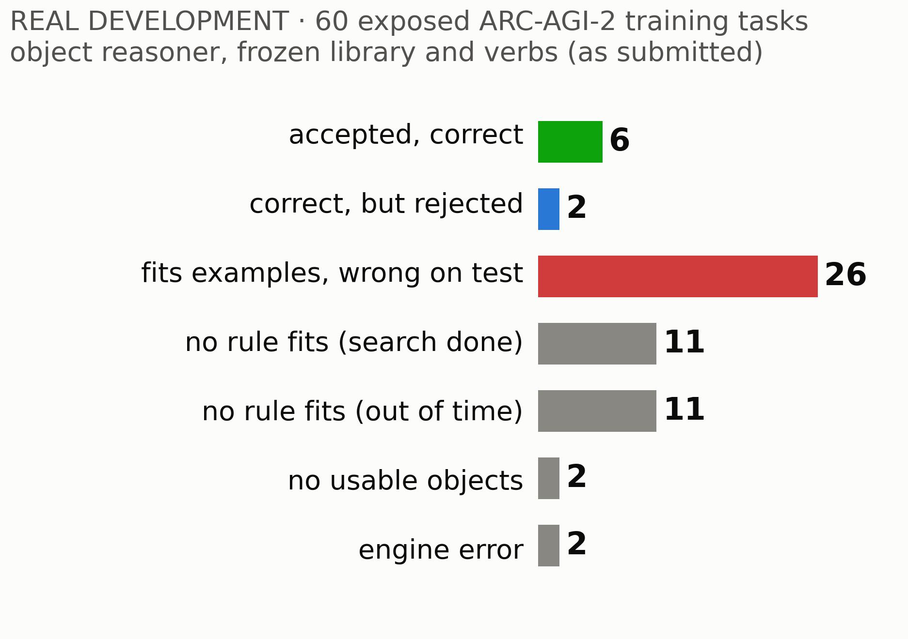

#+TITLE: Learning What to Change: the cancer-lesion poster, explained (V2)
#+SUBTITLE: Speaker explainer for poster_cancer_lesion_review.pdf
#+AUTHOR: Chimdi Walter Ndubuisi, University of Missouri
#+DATE: 19 October 2026 · REVIEW DRAFT V2 for collaborator review, not for circulation
#+LATEX_CLASS: summit-article
#+OPTIONS: toc:nil num:t ^:nil title:t author:t date:t
# ---------------------------------------------------------------------------------------------------------------------
# CANCER-LESION EXPLAINER, V2 (19 October 2026). The source of truth for explainer_cancer_lesion_review.pdf.
# Derived from explainer_science_first_review.org (unchanged). Section 2 is new: the REAL medical image (ISIC_0000013,
# CC-0), used as motivation only; its full provenance is CANCER_LESION_IMAGE_PROVENANCE.md. It is not CORA data.
# Build:  sh scripts/build_summit_org.sh explainer_cancer   (Org -> LaTeX -> PDF; see ORG_TO_PDF_README.md)
# Edit:   ordinary Org. Figures are links into figures/ (same folder as this file); their provenance is
#         figures/PROVENANCE.json. Diagrams are TikZ export blocks. Every CORA number is in
#         records/CORA_SUMMIT_CLAIM_LEDGER_20261017.md. Changes from the science-first set: CANCER_LESION_POSTER_CHANGELOG.md.
# ---------------------------------------------------------------------------------------------------------------------
#+LATEX_HEADER: \usepackage[a4paper, margin=2.2cm]{geometry}
#+LATEX_HEADER: \usepackage[scaled]{helvet}\renewcommand{\familydefault}{\sfdefault}
#+LATEX_HEADER: \usepackage[T1]{fontenc}\usepackage{microtype}\usepackage{graphicx}\usepackage{float}\usepackage{booktabs}
#+LATEX_HEADER: \usepackage{xcolor}\usepackage{enumitem}\usepackage{amssymb}\usepackage{needspace}
#+LATEX_HEADER: \usepackage[nobottomtitles*]{titlesec}\usepackage{caption}
#+LATEX_HEADER: \usepackage{tikz}\usetikzlibrary{positioning, arrows.meta, calc}
#+LATEX_HEADER: \usepackage{tabularx}\newcolumntype{Y}{>{\raggedright\arraybackslash}X}\usepackage{newunicodechar}\newunicodechar{→}{\ensuremath{\rightarrow}}
#+LATEX_HEADER: \usepackage[hidelinks]{hyperref}
#+LATEX_HEADER: \pdftrailerid{}\hyphenpenalty=10000\exhyphenpenalty=10000\setlength{\parindent}{0pt}\setlength{\parskip}{0.5em}
#+LATEX_HEADER: \setlist{itemsep=0.15em, topsep=0.2em, parsep=0pt}\captionsetup{font=small, labelfont=bf}
#+LATEX_HEADER: \definecolor{ink2}{HTML}{52514E}\definecolor{accent}{HTML}{2A78D6}\definecolor{critical}{HTML}{D03B3B}
#+LATEX_HEADER: \definecolor{warm}{HTML}{EB6834}\definecolor{neutral}{HTML}{F0EFEC}\definecolor{band1}{HTML}{FDEBD3}\definecolor{band2}{HTML}{FADBD8}
#+LATEX_HEADER: \tikzset{stage/.style={rounded corners=4pt, draw=accent, line width=1.1pt, fill=white, align=center, font=\small, text width=2.5cm, inner sep=4pt, minimum height=1.25cm},
#+LATEX_HEADER:   pstage/.style={stage, dashed, draw=ink2}, ctx/.style={stage, draw=none, fill=neutral},
#+LATEX_HEADER:   flow/.style={-{Latex[length=2.4mm]}, line width=0.9pt, draw=ink2}, dflow/.style={flow, dashed}}
#+LATEX_HEADER: \titleformat{\section}{\Large\bfseries}{\thesection}{0.6em}{}\titlespacing*{\section}{0pt}{1.1em}{0.4em}
#+LATEX_HEADER: \titleformat{\subsection}{\large\bfseries\color{accent}}{\thesubsection}{0.5em}{}
#+LATEX_HEADER: \urlstyle{same}
#+LATEX_HEADER: \usepackage{flafter}

#+LATEX: \raggedright

A lesion can be seen and its boundary marked; those observations alone do not determine the underlying biological
mechanism. The broader research question is how a system can determine whether to revise its representation, its
explanation or the evidence it needs. ARC gives us a controlled computational place to test parts of that problem.

*Two terms used throughout.* *ARC* (Abstraction and Reasoning Corpus): coloured-grid puzzles where a few examples define
a transformation to apply to a new input. *CORA:* my object-based program-synthesis system, which writes and tests
executable rules for ARC puzzles.

*How to use this.* Read the plain text aloud when presenting. The medical image is real and public; the maize tile is
real and comes from the author's unpublished study. Both are labelled on their faces as not CORA data, and CORA has
never processed either. Every ARC figure is reproduced from
recorded, hash-pinned data, or it says ILLUSTRATIVE on its face. Every CORA number comes from the claim ledger
(=records/CORA_SUMMIT_CLAIM_LEDGER_20261017.md=), with its scope; every fact about the image comes from its archive
record (section [[#sec-medical]]). The poster is review draft V2 for Toni, Chris and Pierce; nothing here is a
print-approved claim.

* The question, and why it is hard
:PROPERTIES:
:CUSTOM_ID: sec-question
:END:

*The question.* How can a machine learn the representation and rules of new data, learn from failure, and know what to
reconsider when its explanation is not enough? Learning from failure is the central theme: a failed check should tell
the system what to change.

- *Representation versus objects.* The representation is the whole description a system builds of the data. Objects
  are one part of it: which pixels, cells or lesions count as one thing. The rest is which relations and features
  matter. Two systems can look at the same image, choose different objects, and then need different rules.
- *Rules.* What the objects do. In ARC, a rule is a program that turns each input grid into its output grid.
- *Why "new" data.* The system is not given the objects or the rules in advance. Each ARC task is new to the solver,
  and in science the right entities are part of what has to be inferred. A system that already knew them would only
  need to look them up.
- *Failure.* An explanation fails when no rule fits, when rival rules fit but disagree, or when a rule breaks with one
  example hidden. Learning from failure means using that observable failure to decide what to revise (the
  representation, the rule or the evidence), or to abstain.

This is a research question, not an achievement. CORA makes parts of it executable and measurable in one controlled
setting, ARC. It has not solved the general problem, and it has not been applied to medicine or biology.

*The 20-second version* (about 60 spoken words). I ask how a machine can learn the representation and rules of new
data, learn from failure, and know what to reconsider when its explanation is not enough. A melanoma and a maize leaf
carry expert outlines, but outlining a lesion does not explain it. In ARC puzzles, my system CORA often finds no rule
that fits, and learning which revision helps is open.

*The 90-second version* (about 225 spoken words; /italic cues/ are not spoken).

- /[The question at the top.]/ My question is how a machine can learn the representation and rules of new data, learn
  from failure, and know what to reconsider when its explanation is not enough. Representation means what counts as an
  object.
- /[Panels A, B and C.]/ This real dermoscopic image's public record says the lesion is an invasive melanoma, confirmed
  by histopathology; panel B adds the archive's expert-reviewed outline. Panel C is a magnified leaf from my own maize
  study, with its expert-corrected annotation.
- /[The question mark.]/ Outlining a lesion is representation. Explaining which biological process produced it needs
  independent clinical, histological or molecular evidence, which neither the picture nor my system provides.
- /[Trace the loop.]/ So I study learning from failure in a controlled place: ARC, coloured-grid puzzles where a few
  examples define a transformation. My system, CORA, finds objects, writes rules as programs and tests them. If a check
  fails, it chooses what to revise, tests the revision and tries again.
- /[Orange band, then pink band.]/ Bottleneck one is measured: often no rule fits, within what CORA can express and its
  search limits. Bottleneck two is open: choosing the revision that helps has not yet beaten a version that ignores the
  failure.
- /[ka95aa62f67d9, then 0 / 58.]/ Here CORA built a new rule and rebuilt it with each example hidden, but the
  failure-ignoring version found it too. On 58 more tasks, building rules verified nothing new.
- /[The dashed box.]/ Next is a trained guide that would rank what CORA tries first. It is proposed; there is no result
  yet.

* A real medical observation: seeing, outlining, diagnosing, explaining
:PROPERTIES:
:CUSTOM_ID: sec-medical
:END:

#+NAME: fig:lesion
#+CAPTION: The poster's panels A and B: a REAL MEDICAL IMAGE, used as motivation only, not CORA data. A: ISIC_0000013 as published by the ISIC Archive, resized for display. B: the same image with the outline of its own ISIC 2018 Task 1 ground-truth mask drawn on top. Both files are CC-0; the record's attribution is "Anonymous". The diagnosis lines quote the archive record; nothing was read off the picture.
#+ATTR_LATEX: :width 0.52\linewidth :placement [H]
[[file:figures/fig_skin_lesion_ISIC_0000013_with_boundary.png]]

The poster opens with a dermoscopic image: a magnified, illuminated view of the skin surface. It makes the poster's
question concrete. It does not show anything CORA can do: CORA has never processed this or any other medical image.

#+LATEX: \needspace{10\baselineskip}
*Four layers that are easy to confuse.* Each needs its own evidence:

#+ATTR_LATEX: :environment tabularx :width \linewidth :align p{3.3cm}YY
| layer                    | the question it answers                | what this example has                                                                |
|--------------------------+----------------------------------------+--------------------------------------------------------------------------------------|
| seeing                   | what is in the image?                  | the photograph (panel A)                                                             |
| localization             | where is the lesion?                   | an expert-reviewed mask (panel B): a spatial annotation, not a diagnosis             |
| diagnostic pathology     | what kind of lesion is it?             | the archive's recorded diagnosis, invasive melanoma, established by histopathology   |
| molecular causation      | which biological process produced it?  | nothing: the image, the mask and the record do not establish a mechanism            |

- *A boundary says where, not what or why.* The mask marks which pixels belong to the lesion. A segmentation system that
  reproduced it perfectly would have localized the lesion, not diagnosed or explained it.
- *A diagnosis comes from tissue, not from this picture.* The record states that the diagnosis was confirmed by
  histopathology, the microscopic examination of tissue. This work quotes that record. No one in this work read a
  diagnosis, a histological feature or a prognosis off the image, and the poster draws no such inference.
- *Even a confirmed diagnosis does not name a mechanism.* A diagnosis places the lesion in a disease category. Which
  biological processes produced this particular lesion would need further evidence from the tissue itself, such as
  molecular or experimental measurements. This example has none, and none is claimed.
- *Why this fits the poster's question.* The poster's three layers (observe; represent; explain and test) are the
  layers in which any reasoning system can be wrong. A system can see correctly and still segment wrongly. It can
  segment correctly and still explain wrongly. Recognizing *which* layer is inadequate is the part CORA studies, in ARC,
  where every layer can be checked exactly.

** Provenance of the image and the mask
:PROPERTIES:
:CUSTOM_ID: sec-provenance
:END:

- *Image.* ISIC_0000013, a dermoscopic JPEG of 1022 × 767 pixels, from the ISIC Archive (International Skin Imaging
  Collaboration). Record: [[https://api.isic-archive.com/api/v2/images/ISIC_0000013/]]. File:
  # (raw \url: a plain Org link to a .jpg would be treated as an inline image to fetch, which the offline build refuses)
  @@latex:\url{https://isic-archive.s3.amazonaws.com/images/ISIC_0000013.jpg}@@.
- *Licence and attribution.* The record's =copyright_license= is CC-0 and its =attribution= is "Anonymous". The poster
  prints both next to the image.
- *Documented diagnosis.* From the same record: =diagnosis_1= "Malignant"; =diagnosis_2= "Malignant melanocytic
  proliferations (Melanoma)"; =diagnosis_3= "Melanoma Invasive"; =diagnosis_confirm_type= "histopathology";
  =concomitant_biopsy= true. The record also holds de-identified clinical fields such as approximate age and body site.
  They are not shown or used.
- *Mask.* =ISIC_0000013_segmentation.png=, from the ISIC 2018 Task 1 training ground truth,
  [[https://isic-archive.s3.amazonaws.com/challenges/2018/ISIC2018_Task1_Training_GroundTruth.zip]] (2,597 entries).
  The challenge data page, [[https://challenge.isic-archive.com/data/]], lists the 2018 Task 1 data as CC-0.
- *How the masks were made.* The Task 1 page says that the ground truth "data were generated using several techniques,
  but all data were reviewed and curated by practicing dermatologists with expertise in dermoscopy". Each mask came
  from one of three methods: an automated algorithm whose output a human expert reviewed and accepted, a semi-automated
  flood fill with parameters chosen by a human expert, or manual polygon tracing by a human expert. The page does not
  say which method made this mask.
- *Proof that the mask belongs to this image.*
  1. The mask's file name carries the same ID.
  2. The image is in the archive's collection 63, "Challenge 2018: Task 1-2: Training", the image set that these masks
     annotate.
  3. The mask has the image's exact size (1022 × 767). It is binary (values 0 and 255) and marks 27.6% of the pixels.
  4. The outline follows the lesion's edge (panel B).

  The figure script stops if the size differs. No unrelated photograph, pathology slide or record is paired with this
  image.
- *How it was found and downloaded* (19 October 2026). An API search,
  =images/search/?collections=63&query=diagnosis_1:Malignant AND diagnosis_confirm_type:histopathology AND
  copyright_license:CC-0=, returned 519 images. Twelve 256-pixel thumbnails from the first page were compared for
  legibility at poster size. ISIC_0000013 was chosen because:
  - the whole lesion is in the frame;
  - its boundary is sharp against light skin;
  - there is no dark vignette, dense hair, ruler, ink mark or graphic surface;
  - its record gives a specific diagnosis.

  The record and the image came from the API, the mask from the zip. Each file was saved in its own new folder, and
  its sha256 was recorded (figures/PROVENANCE.json and =CANCER_LESION_IMAGE_PROVENANCE.md=). No CORA result played any
  part in the choice.
- *Transformations.* Panel A is the original JPEG resized for display: no crop, no colour change. Panel B is the same,
  with the contour of the mask (pixels > 127) drawn as a 2.6 pt cyan line.

** Panel C: the author's annotated maize leaf
:PROPERTIES:
:CUSTOM_ID: sec-maize
:END:

#+NAME: fig:maize
#+CAPTION: Panel C of the poster: a REAL maize leaf from the author's study (unpublished), not CORA data. A crop of leaf DSC_0042, magnified ×2 by repeating pixels, with the outline of its expert-corrected lesion annotation in cyan.
#+ATTR_LATEX: :width 0.3\linewidth :placement [H]
[[file:figures/fig_maize_annotated_DSC_0042_crop_x2.png]]

- *Leaf and files.* =DSC_0042_segment_1_segmented_smoothed=, from the author's maize lesion study in
  =segmentors_backbones=. The photograph is the stored PNG that Project A's loader reads (3900 × 851 pixels). The
  annotation is its expert-corrected lesion mask (values 0 and 255). Both are read in place and never copied into this
  repository or modified; their sha256 hashes are pinned in the figure script.
- *Why this leaf.* It is leaf 1 of the fixed, ID-gated cohort of the real-leaf gallery
  (=projects/real_leaf_gallery_20261018=). It is a Project A validation leaf: not one of the 25 development leaves, not
  one of the five consumed test leaves, and not from the reserved 26r collection.
- *Why this crop.* A rule fixed before the tile was rendered: a 360 × 214-pixel window, at least 99% on the leaf,
  holding the most complete annotated lesions of at least 500 pixels (Project A's matching size). Ties go to more
  annotated pixels, then to the top-left. The rule selects rows 280–494 and columns 459–819, with 6 complete lesions;
  the whole leaf has 61.
- *How it is drawn.* The crop is magnified ×2 by repeating pixels: no interpolation and no colour change. The cyan line
  is the contour of the annotation, binarised as Project A does (mask > 0).
- *What it does not show.* An annotation marks where lesions are. It does not say which genes or processes produce
  them, and the tile is not a Project A, Project C or CORA result.

*Why both a skin lesion and a maize leaf.* The author's own research studies lesions on maize leaves, including
lesion-mimic mutants, which form spots of dead tissue without a pathogen. Panel C shows one annotated leaf from that
study; its genotype and the cause of its lesions are not stated here. The skin image adds what the maize tile cannot: a
public, licensed example with an expert-reviewed outline *and* a histopathology-confirmed diagnosis. With it, the gap
between outlining, diagnosing and explaining can be shown with documented facts. In both, finding the lesions does not
explain them.

* The reasoning loop and its two bottlenecks
:PROPERTIES:
:CUSTOM_ID: sec-pipeline
:END:

#+NAME: fig:pipeline
#+ATTR_LATEX: :options [t]
#+CAPTION: The poster's reasoning loop, which learns from failure. Solid: implemented and tested in CORA. Dashed: proposed or not yet validated. Grey: context, not a CORA component. Shading marks the two bottlenecks.
#+BEGIN_figure
#+BEGIN_EXPORT latex
\centering
\begin{tikzpicture}
  \tikzset{n/.style={stage, text width=4.2cm, minimum height=1.05cm}, pn/.style={pstage, text width=4.2cm, minimum height=1.05cm},
           cn/.style={ctx, text width=4.2cm, minimum height=1.05cm}}
  \fill[band1, rounded corners=4pt] (-2.75,-6.25) rectangle (2.75,-2.75);
  \fill[band2, rounded corners=4pt] (3.05,-9.85) rectangle (8.15,-8.15);
  \node[cn] (q) at (0,0) {\textbf{scientific question}\\what explains an observation?};
  \node[cn] (o) at (0,-1.8) {\textbf{observations}\\images, measurements, ARC grids};
  \node[n] (f) at (0,-3.6) {\textbf{find objects and relations}\\what counts as an object};
  \node[n] (p) at (0,-5.4) {\textbf{propose executable rules}\\explanations as programs};
  \node[n] (e) at (0,-7.2) {\textbf{execute and test}\\on the visible examples};
  \node[n] (s) at (0,-9.0) {\textbf{supported or failed?}\\rival rules; each example hidden};
  \node[n] (v) at (0,-10.8) {\textbf{predict}, then evaluate independently};
  \foreach \a/\b in {q/o, o/f, f/p, p/e, e/s} \draw[flow] (\a) -- (\b);
  \draw[flow] (s) -- node[right, font=\scriptsize, text=ink2] {supported} (v);
  \node[pn] (r) at (5.6,-9.0) {\textbf{choose what to revise}\\objects, rule, evidence, abstain};
  \node[n] (t) at (5.6,-5.4) {\textbf{test the revision}\\keep or reject};
  \node[pn] (l) at (-6.2,-5.4) {\textbf{learned guide}\\proposed: ranks what to try first};
  \draw[flow] (s) -- node[above, font=\scriptsize, text=ink2] {failed} (r);
  \draw[dflow] (r) -- (t);
  \draw[dflow] (t) -- node[above, font=\scriptsize, text=ink2] {retry} (e.north east);
  \draw[dflow] (l) -- node[above, font=\scriptsize, text=ink2] {proposals} (p);
  \draw[dflow] (l.south) -- (-6.2,-12.0) -| node[pos=0.25, below, font=\scriptsize, text=ink2] {what to revise} ($(r.south)+(-1.6,0)$);
  \node[font=\scriptsize\bfseries, text=warm, anchor=east, align=right] at (-2.85,-3.1) {bottleneck 1\\(measured)};
  \node[font=\scriptsize\bfseries, text=critical, anchor=north] at (6.4,-9.9) {bottleneck 2 (unresolved)};
  \node[font=\scriptsize\itshape, text=ink2, anchor=east] at (-2.45,-9.0) {visible evidence only};
\end{tikzpicture}
#+END_EXPORT
#+END_figure

The loop in figure [[fig:pipeline]] is the poster's main figure. Each arrow means:

1. *Scientific question → observations.* A question picks the data: images, molecular measurements, or, in this work, ARC
   input and output grids. Grey boxes are context, not parts of CORA.
2. *Find objects and relations.* Decide what counts as an object and which relations matter. In CORA this is one of seven
   segmentation views of a grid. This is the *representation*.
3. *Propose executable rules.* Write an explanation as a program that can be run: a *rule*. CORA proposes programs by
   searching its typed language, by native induction from object changes, or by constructing a missing operation.
4. *Execute and test.* Run each rule on every demonstration. A rule that reproduces every demonstration exactly *fits*.
5. *Supported or failed?* A fitting rule may still fail. Rival rules may fit and disagree on the new input, or a rule
   may break when one demonstration is hidden and the rule is rebuilt from the rest (*insufficient evidence*). If no
   rule fits at all, that is a failure too. This decision uses visible evidence only: CORA never sees the hidden test
   answer.
6. *Predict, then evaluate independently.* A supported rule predicts the new output. A separate evaluator, which alone
   reads the answers, scores it later.
7. *Choose what to revise: the learning-from-failure step.* After a failure, decide whether to change the objects,
   the rule, or the evidence and search, or to abstain. This choice is *not* validated (dashed).
8. *Test the revision.* Install the change reversibly, re-test it, and keep it only if it passes the same checks. A
   tested revision is not automatically a correct explanation.
9. *Learned guide (proposed; called Neural-CORA in the records).* A trained model would rank which rules and
   revisions to try first, *inside* this loop. It never produces an answer by itself (section [[#sec-neural]]).

*Bottleneck 1 is measured.* Most failures happen before any test. Within the operations CORA can express (its rule
language) and its search limits (its budgets), CORA often has no rule that fits. On 58 separately selected tasks,
construction proposed no rule for 55; in Phase 2a, no hypothesis in CORA-v2's language fit 33 of 40 tasks (section
[[#sec-negative]]). *Bottleneck 2 is unresolved,* and it is the learning-from-failure step. Even when a failure is
visible, no way of choosing the revision has yet been shown to beat a version that ignores the failure
(*failure-blind*) given the same compute (*compute-matched*).

An observable diagnostic is not knowledge of the hidden answer. CORA can see that two of its rules disagree, or that one
demonstration alone supports a rule. It cannot see whether its prediction is right.

* Why ARC-AGI-2 is the testbed
:PROPERTIES:
:CUSTOM_ID: sec-arc
:END:

ARC-AGI-2 is a deliberately simplified environment. Each task gives two to five demonstration pairs (an input grid and
its output grid) and one new input. The solver must produce the new output exactly, with two attempts. The answer is
exact, the evidence is small, and every rule can be executed and checked, so representation, rule and evidence can be
studied one at a time.

#+NAME: fig:arc
#+CAPTION: A real public training task, 00dbd492, drawn cell for cell from the recorded bundle. Each frame is filled with a colour set by its size. The task was examined during development; here it only shows what an ARC task is.
#+ATTR_LATEX: :width 0.5\linewidth :placement [H]
[[file:figures/fig_arc_intro_00dbd492_large.png]]

*Memorization versus generalization.* "Paint the cells that changed in example 1" fits example 1 and fails elsewhere:
it memorizes. "Fill each frame with the colour its size calls for" generalizes. Both fit the demonstrations they were
built from, and that is the difficulty: fitting is not explaining.

#+NAME: fig:causes
#+CAPTION: ILLUSTRATIVE: three possible causes of a failed explanation, drawn to explain, not ARC tasks and not CORA results. Wrong objects: the same grid splits into two or three objects. Wrong rule: the available operations (move, recolour) cannot draw the line. Not enough evidence: "bars of two turn red" and "the top bar turns red" fit the same example and disagree on a new input.
#+ATTR_LATEX: :width \linewidth :placement [H]
[[file:figures/fig_three_causes_row_ILLUSTRATIVE.png]]

* What CORA implements today
:PROPERTIES:
:CUSTOM_ID: sec-cora
:END:

CORA is an executable reasoner. Every hypothesis is a program that a fixed interpreter runs on the demonstrations.

- *Native CORA (frozen v23).* It segments a grid into objects in seven views, searches for an object program
  (select objects, then keep, delete, recolour, move, copy, grow, ...), and accepts only programs that reproduce every
  demonstration and are rebuilt when each demonstration is held out in turn.
- *Rule construction (CORA-FHR, failure-conditioned hypothesis revision).* It reads native's own failure trace and
  constructs a missing growth operation from a fixed typed grammar of 37,750 expressions. It installs the operation
  reversibly and keeps it only if the unchanged engine uses it and every held-out fold rebuilds it.
- *CORA-v2, the hypothesis reasoner.* It keeps every hypothesis (representation, geometry, colour policy) that
  reproduces every demonstration. It abstains when they disagree, reruns the search with each demonstration held out,
  and labels *why* it is unsure with observable diagnoses. Exploratory guesses are kept apart from certified answers.
- *Present versus proposed.* Solid in figure [[fig:pipeline]]: objects, executable rules, execution, the support check,
  the tested revision and the separate evaluator. Dashed: choosing which revision to make, and any learned guide.

* Recorded evidence: a rule CORA built
:PROPERTIES:
:CUSTOM_ID: sec-witness
:END:

#+NAME: fig:ka95
#+CAPTION: Real grids from the recorded bundle of task ka95aa62f67d9 (a training example with its target output; the new input with CORA's output, which equals the evaluator's answer).
#+ATTR_LATEX: :width 0.64\linewidth :placement [H]
[[file:figures/fig_real_rule_ka95aa62f67d9_large.png]]

- *The rule CORA constructed.* If an object's colours are {1}, a ray goes north-west from its centre to the border;
  otherwise south-east. In ARC colours: *blue objects send a line up-left, red objects down-right*, each in the object's
  own colour.
- *The checks.* The rule was installed reversibly in the unchanged engine and rebuilt in 3 of 3 held-out folds. Its
  output equals the evaluator's answer. Frozen native CORA and matched extra search do not solve this task.
- *Why it is narrow.* The task was chosen in development by a failure autopsy, and it is an exposed public training task.
  A constructor that ignored the failure record found the same rule. So the run shows that CORA can *construct and verify*
  a missing rule. It does not show that diagnosing the failure *caused* the gain.
- *The offline demo* (=sh docs/summit_demo_20261023/run_demo.sh --real=) replays the recorded run and re-executes the
  constructed operation as standalone code. It is not a live rerun of the full engine.

* Negative evidence and the measured bottleneck
:PROPERTIES:
:CUSTOM_ID: sec-negative
:END:

#+NAME: fig:58
#+CAPTION: The 58-task generalization test of rule construction, one square per task, for the arm that used the failure record. No rule was proposed on 55 tasks; on 3, a rule was proposed but rejected (2 by the unchanged engine, 1 by the held-out rebuild); 0 verified.
#+ATTR_LATEX: :width 0.95\linewidth :placement [H]
[[file:figures/fig_construction_58_outcomes.png]]

- *The 58-task test.* 58 separately selected, still exposed training tasks, under a protocol frozen before the run. No
  construction arm (with the failure record, failure-blind, shuffled, contrast) produced a verified new answer: 0 of 58,
  with 0 wrong and 0 lost. The failure-blind arm: 52 no rule, 5 engine rejections, 1 held-out failure. Frozen native
  solved 1, which is not a construction result.
- *A restricted check on why.* An evaluator-only analysis, which reads the answers and is used only for diagnosis, asked
  whether a *single, uniformly applied* growth expression could explain the changed cells in any of native's seven
  views. For 50 of 58 tasks it could not. This supports an expressivity hypothesis inside that one class. It does not
  show that the tasks need new semantics or are impossible for CORA.
- *Fitting is not enough, measured.* On 60 exposed development tasks, CORA's object reasoner accepted 6 answers, all
  correct. On 26 tasks every rule that fit the demonstrations failed the test (figure [[fig:dev60]]).
- *Thin evidence, flagged.* CORA-v2 certified no answer on 118 exposed development tasks; its exploratory guesses were 4
  correct and 1 wrong. On 00dbd492 its 1,365 consistent hypotheses agree and the guess is correct, but the colour for
  the largest frame is shown by one demonstration only. Hidden, that demonstration leaves the rebuilt rule without an
  answer, so v2 keeps the guess uncertified (figure [[fig:v2]]).
- *Phase 2a (finished and evaluated, NO-GO).* On 40 freshly selected public training tasks, frozen native and matched
  search each certified 6 answers (5 correct, 1 wrong). CORA-v2 certified none; its 2 exploratory answers were correct,
  one of them new. The frozen GO rule needed 2 new correct answers, so the version was closed without retuning. On 33
  of the 40 tasks no hypothesis in v2's language fit at all: the same bottleneck.

#+NAME: fig:dev60
#+CAPTION: The 60-task audit of native CORA's object reasoner, as submitted, on exposed training tasks. This is one branch; the whole harness solved 12 of 60 over two attempts.
#+ATTR_LATEX: :width 0.75\linewidth :placement [H]

#+NAME: fig:v2
#+CAPTION: CORA-v2 on 00dbd492 (development run): a correct but uncertified prediction. The fill colour for the largest frame rests on one demonstration.
#+ATTR_LATEX: :width 0.8\linewidth :placement [H]
[[file:figures/fig_v2_uncertified_00dbd492_large.png]]

* Why NVARC, and why neural learning
:PROPERTIES:
:CUSTOM_ID: sec-nvarc
:END:

- *What was reproduced.* NVARC is the NVARC team's published ARC Prize 2025 method. I deployed their public notebook with
  six changes, all for deployment (compatibility, coverage, diagnostics, provenance, robustness). Unchanged: their
  Qwen3-4B checkpoint, their per-task test-time training, decoding, scoring and selection.
- *What Qwen learned in that method.* For each task, NVARC briefly trains a small adapter on the task's demonstrations
  (eight rotations and reflections × sixteen colour permutations), then decodes and scores candidate grids. This is
  learning within a task; the model emits grids, not programs.
- *Attribution.* 27.64% is the official public score of my deployment of their method (Kaggle 57160429). It is not a CORA
  result and not a Neural-CORA result. Native CORA and CORA with rule construction scored 0.00% (57144804, 57354496).
- *Why combining answers failed.* On 240 exposed stand-in tasks, NVARC got 248 of 259 outputs and CORA 47; CORA solved
  none that NVARC missed. Filling NVARC's empty second attempts with CORA's answers gained 0 and lost 1. On the hidden set
  CORA scored 0.00, so its grids could add nothing there.
- *An earlier neural negative.* A frozen, prompted Qwen2.5-1.5B that ranked CORA's seven segmentation views did not beat
  a fixed order (35 of 35 against 19), and failure traces made it worse (1 of 35, the same as shuffled traces).
- *Why a trained guide inside CORA is a different hypothesis.* It would be trained, not prompted. It would order a
  search space of thousands to millions of typed programs, where no fixed order can be best for everything, instead of
  choosing one of seven views. It uses no failure traces, and it must beat strong symbolic search under matched
  compute.

* The proposed learned guide inside CORA (Neural-CORA)
:PROPERTIES:
:CUSTOM_ID: sec-neural
:END:

One inference algorithm, owned by CORA; not a router, an ensemble or a second-attempt filler (figure [[fig:neural]]).

#+NAME: fig:neural
#+ATTR_LATEX: :options [H]
#+CAPTION: The proposed learning component inside CORA. Solid: CORA's existing typed rules, interpreter and prediction. Dashed: the trained guide and the feedback that would revise it; not yet validated.
#+BEGIN_figure
#+BEGIN_EXPORT latex
\centering
\begin{tikzpicture}
  \tikzset{n/.style={stage, text width=3.6cm}, pn/.style={pstage, text width=3.6cm}}
  \node[pn] (a) at (0,0) {trained guide\\(Qwen3-4B encoder + heads)};
  \node[n] (b) at (5.2,0) {CORA typed rules};
  \node[n] (c) at (5.2,-1.9) {run and check on the examples};
  \node[pn] (d) at (0,-1.9) {observable feedback};
  \node[n] (e) at (10.4,-1.9) {CORA's prediction};
  \draw[dflow] (a) -- node[above, font=\scriptsize, text=ink2] {order} (b); \draw[flow] (b) -- (c); \draw[dflow] (c) -- (d);
  \draw[dflow] (d) -- node[left, font=\scriptsize, text=ink2] {revise} (a); \draw[flow] (c) -- (e);
\end{tikzpicture}
#+END_EXPORT
#+END_figure

- *CORA's typed state:* representation (a segmentation view), one or two first-match rules (selector and native action,
  additive or not), a default, and the evidence: which demonstrations fit, fold outcomes, rival predictions, cost.
- *The trainable guide* (a learned prior): the frozen NVARC Qwen3-4B checkpoint reads the demonstrations in its own grid format. A small
  trainable head turns its hidden states into scores over program components. The scores only *order* CORA's search.
- *Execution and selection:* the unchanged native interpreter runs each candidate; the same fixed rule picks two
  attempts for every arm. No neural grid reaches an attempt.
- *Fold-locality:* a guide adapted on all demonstrations cannot certify a fold; its proposals are labelled
  neural-assisted unless the adaptation is repeated without the held-out demonstration.
- *Status, 19 October:* the typed language compiles to native programs and runs through the native interpreter; CORA's
  own synthetic task generator (execution-validated, no third-party data) and the arms are implemented, with unit tests.
  Development smoke tests have run on synthetic tasks; training has not started. *There is no result.* The pilot
  protocol is frozen before any scored run.

* How the idea could be falsified
:PROPERTIES:
:CUSTOM_ID: sec-falsify
:END:

Every arm uses the same inputs, the same interpreter and the same checker:

#+ATTR_LATEX: :environment tabularx :width \linewidth :align lYY
| arm      | what it is                                                     | what it controls                    |
|----------+----------------------------------------------------------------+-------------------------------------|
| C0       | native CORA's own inducer                                      | the original system                 |
| C+       | simplest-first search, twice the learned budget                | extra symbolic search               |
| C+H      | C+ plus a hand-designed analysis of the changes                | strong symbolic search              |
| L0, L0s  | the same guide untrained, or trained on shuffled targets       | does training matter?               |
| L1       | the trained guide                                              | the hypothesis                      |
| L1h      | the same heads on hand-crafted features                        | does the neural encoder matter?     |
| N0, N+   | unchanged NVARC; NVARC with matched extra compute              | the neural baseline (later stages)  |

Three outcomes must be kept apart: *candidate coverage* (a correct program is proposed at all), *exact accuracy* (the two
attempts are right), and *diagnostic benefit* (authentic feedback chooses revisions better than blind or shuffled
feedback). If the trained guide cannot beat C+ under matched resources on held-out task families, the result is NO-GO
and the bottleneck is diagnosed before any larger model is trained.

* People and the broader programme
:PROPERTIES:
:CUSTOM_ID: sec-people
:END:

- *Toni Kazic.* The broader question behind the poster was discussed with Toni in a recorded conversation (transcript:
  =voice_note/arc_conversatn.md=). The poster's wording is the author's; Toni's preferred wording is to be confirmed.
- *Chris.* The 2025 ARC work with Chris (the slides list Christian Fluharty, Computer Science, as co-presenter;
  identity and naming to be confirmed) used LLM proposals with a program language, which this work builds on in spirit.
- *Pierce Taylor.* A joint project with Pierce and Toni exists (=sb_class_project=). Its description, and any biological
  test of a revision procedure, await Pierce's review. No conclusion from it is reported here.
- *The images.* The medical image comes from the public ISIC Archive, not from any collaborator or clinic. The maize
  tile comes from the author's own unpublished maize study; its public display should be confirmed with the data's
  owners (including Toni, if the leaves belong to the lab collection) before print.
- *What could transfer* is the revision policy and the verification discipline, not ARC operations. Medicine and
  biology remain future, untested work.

* Reproduction, terms and responsible claims
:PROPERTIES:
:CUSTOM_ID: sec-repro
:END:

- *Figures:* =python scripts/summit_visual_figures.py= stops if any pinned input's hash differs, if the ISIC record's
  licence, diagnosis fields or the mask size differ from what this explainer states, or if the maize crop rule selects
  a different window. Provenance is in
  =figures/PROVENANCE.json=; the image's is also in =CANCER_LESION_IMAGE_PROVENANCE.md=.
- *This explainer and the poster:* =sh scripts/build_summit_org.sh cancer= exports each =.org= to LaTeX with Emacs and
  compiles that export. =sh scripts/build_summit_org.sh selftest= proves the =.org= files are the real sources. Details:
  =ORG_TO_PDF_README.md=. Changes from the science-first set: =CANCER_LESION_POSTER_CHANGELOG.md=.
- *Records:* the claim ledger; =records/CORA_REASONING_V2_PHASE2A_EXECUTION_20261019.md=;
  =records/NEURAL_CORA_ARCHITECTURE_AUDIT_20261019.md=.

*Terms.* /Failed/: no rule fits, rival rules disagree, or a rule breaks when one example is hidden. /Learned guide/
(Neural-CORA): the proposed trained model that ranks what CORA tries first. /Held out/: hidden while a rule is
rebuilt from the other examples; a /fold/ is one such rebuild. /Held-out task families/: kinds of synthetic task never
used in training. /Arm/: one version of a system in a controlled comparison. /Native CORA/: the original, frozen version
(v23); the poster calls it the original CORA. /Dermoscopy/: a magnified, illuminated view of the skin surface. /Segmentation mask/: an
image marking which pixels belong to the lesion. /Histopathology/: microscopic examination of tissue. /Leave-one-out/
(LOO): rebuild a rule with one demonstration hidden and check that it predicts it. /Certified/: unique and rebuilt in
every fold. /Exploratory/: fits every demonstration but is not certified. /FHR/: failure-conditioned hypothesis
revision. /Grammar/ or /rule language/: what a system can express at all. /K2/ and /Step B/: a separate CORA experiment
on inventing new operations, not used here. /Oracle/: an evaluator-only analysis that reads answers for diagnosis only.
/OOD/: tasks unlike those used in development. /Causal claim/: a component caused a gain, shown only by a controlled
comparison. /Exposed task/: already examined in development, so results on it are in-sample. /Version space/: every
hypothesis consistent with the demonstrations.

*Image credits.* ISIC_0000013, ISIC Archive, CC-0, attribution "Anonymous"; its mask: ISIC 2018 Task 1 training ground
truth, CC-0. Maize leaf DSC_0042 and its expert-corrected annotation: the author's maize lesion study (unpublished).
