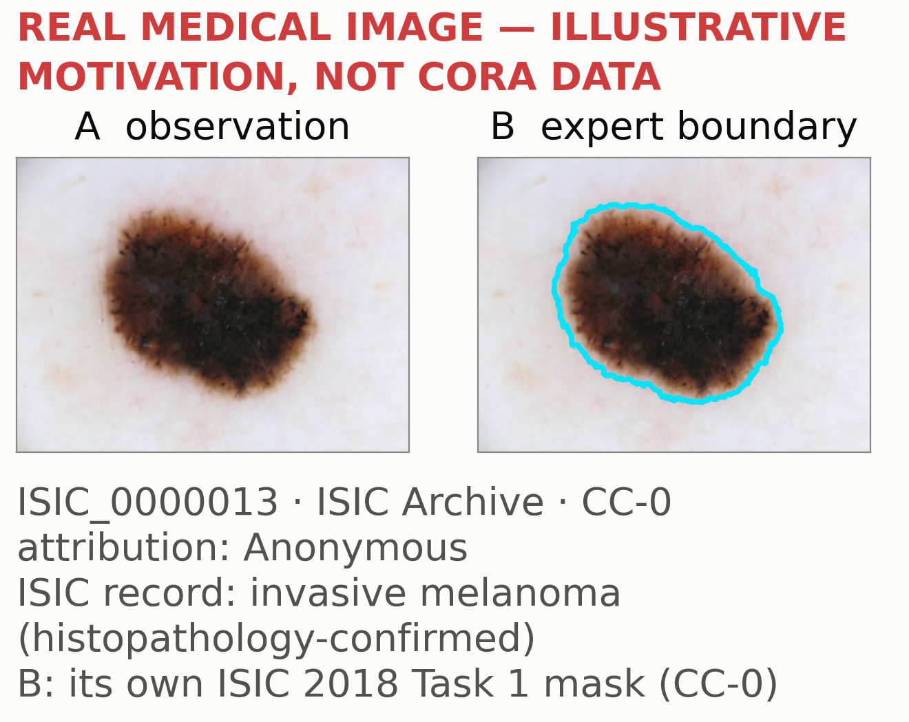

#+TITLE: LEARNING WHAT TO CHANGE
#+AUTHOR: Chimdi Walter Ndubuisi
#+LATEX_CLASS: summit-tikzposter
#+OPTIONS: toc:nil title:nil num:nil date:nil ^:nil author:t
# ---------------------------------------------------------------------------------------------------------------------
# CANCER-LESION REVIEW POSTER, V2 (19 October 2026). The source of truth for poster_cancer_lesion_review.pdf.
# Derived from poster_science_first_review.org (unchanged). The opening uses a REAL medical image (ISIC_0000013, CC-0)
# as motivation only; provenance: CANCER_LESION_IMAGE_PROVENANCE.md. It is not CORA data.
# For collaborator review (Toni, Chris, Pierce) and the user's approval. NOT for print.
# Build:  sh scripts/build_summit_org.sh poster_cancer   (Org -> LaTeX -> PDF; see ORG_TO_PDF_README.md)
# Edit:   change text directly below. Each poster block is a #+BEGIN_posterblock ... #+END_posterblock special block; its
#         title is the {…} in the #+ATTR_LATEX line above it. Columns are the one-line #+LATEX: \column{…} commands.
#         Figures are Org links into figures/ (same folder). Diagrams are the TikZ export blocks.
# Visual truth: SOLID outline = implemented and tested; DASHED = proposed or not validated; GREY = context, not a
#         CORA component. Every number: records/CORA_SUMMIT_CLAIM_LEDGER_20261017.md (see
#         POSTER_SCIENCE_FIRST_CLAIM_AUDIT.md). Figures: figures/PROVENANCE.json. Size: A0 portrait, a REVIEW ASSUMPTION.
# ---------------------------------------------------------------------------------------------------------------------
#+LATEX_HEADER: \RequirePackage{fix-cm}
#+LATEX_HEADER: \usepackage[scaled]{helvet}\renewcommand{\familydefault}{\sfdefault}
#+LATEX_HEADER: \usepackage[T1]{fontenc}\usepackage{graphicx}\usepackage{amssymb}\usepackage{environ}\usepackage{enumitem}
#+LATEX_HEADER: \usetikzlibrary{positioning, arrows.meta, fit, calc, backgrounds}
#+LATEX_HEADER: \pdftrailerid{}\hyphenpenalty=10000\exhyphenpenalty=10000
#+LATEX_HEADER: \newcommand{\bodyfont}{\fontsize{30}{38}\selectfont\raggedright}
#+LATEX_HEADER: \newcommand{\secfont}{\fontsize{26}{32}\selectfont\raggedright}
#+LATEX_HEADER: \newcommand{\diagfont}{\fontsize{26}{31}\selectfont}
#+LATEX_HEADER: \newcommand{\diagsub}{\fontsize{22}{27}\selectfont}
#+LATEX_HEADER: \newcommand{\bignum}[1]{{\fontsize{120}{120}\selectfont\bfseries #1}}
#+LATEX_HEADER: \newcommand{\bt}[1]{{\fontsize{40}{48}\selectfont #1}}
#+LATEX_HEADER: \newcommand{\chip}[2]{{\fontsize{26}{30}\selectfont\color{#1}\,[#2]}}
#+LATEX_HEADER: \definecolor{ink}{HTML}{0B0B0B}\definecolor{ink2}{HTML}{52514E}\definecolor{accent}{HTML}{2A78D6}
#+LATEX_HEADER: \definecolor{warm}{HTML}{EB6834}\definecolor{good}{HTML}{0CA30C}\definecolor{neutral}{HTML}{F0EFEC}
#+LATEX_HEADER: \definecolor{critical}{HTML}{D03B3B}\definecolor{paper}{HTML}{FCFCFB}\definecolor{arcblue}{HTML}{0074D9}
#+LATEX_HEADER: \definecolor{arcred}{HTML}{FF4136}
#+LATEX_HEADER: \definecolor{band1}{HTML}{FDEBD3}\definecolor{band2}{HTML}{FADBD8}
#+LATEX_HEADER: \usetheme{Simple}\tikzposterlatexaffectionproofoff
#+LATEX_HEADER: \colorlet{backgroundcolor}{paper}\colorlet{framecolor}{paper}\colorlet{titlefgcolor}{ink}
#+LATEX_HEADER: \colorlet{titlebgcolor}{paper}\colorlet{blocktitlebgcolor}{paper}\colorlet{blocktitlefgcolor}{accent}
#+LATEX_HEADER: \colorlet{blockbodybgcolor}{paper}\colorlet{blockbodyfgcolor}{ink}
#+LATEX_HEADER: \newcommand{\postersubtitle}{Learning from Failure: Executable Reasoning and Hypothesis Revision}
#+LATEX_HEADER: \newcommand{\posteraffil}{University of Missouri}
#+LATEX_HEADER: \newcommand{\posterstatus}{REVIEW DRAFT V2, 19 October: for collaborator review, not for print}
#+LATEX_HEADER: \makeatletter\settitle{\centering\vbox{\color{titlefgcolor}{\bfseries\fontsize{100}{112}\selectfont \@title\par}\vspace*{0.2em}{\fontsize{50}{60}\selectfont \postersubtitle\par}\vspace*{0.25em}{\fontsize{36}{44}\selectfont\color{ink2} \@author\ \,$\cdot$\, \posteraffil \quad {\color{critical}\posterstatus}}}}\makeatother
#+LATEX_HEADER: \tikzset{stage/.style={rounded corners=8pt, draw=accent, line width=2.6pt, fill=white, align=center, font=\diagfont, inner sep=9pt},
#+LATEX_HEADER:   pstage/.style={stage, dashed, draw=ink2, dash pattern=on 12pt off 7pt},
#+LATEX_HEADER:   ctx/.style={rounded corners=8pt, draw=none, fill=neutral, align=center, font=\diagfont, inner sep=9pt},
#+LATEX_HEADER:   flow/.style={-{Latex[length=8mm,width=6mm]}, line width=2.8pt, draw=ink2},
#+LATEX_HEADER:   dflow/.style={flow, dashed, dash pattern=on 12pt off 7pt},
#+LATEX_HEADER:   lab/.style={font=\diagsub, text=ink2, align=center}}
#+LATEX_HEADER: \NewEnviron{posterblock}[1]{\block{#1}{\BODY}}

#+LATEX: \maketitle[width=0.97\linewidth, titletotopverticalspace=10mm, titletoblockverticalspace=6mm]

# ===================================================== 1. THE QUESTION, MOTIVATED BY ONE REAL MEDICAL OBSERVATION
# The image pair is ISIC_0000013 (CC-0) and its own ISIC 2018 Task 1 ground-truth mask (CC-0); see
# CANCER_LESION_IMAGE_PROVENANCE.md. It motivates the question; it is NOT CORA data and NOT a diagnosis by anyone here.
#+ATTR_LATEX: :options {}
#+BEGIN_posterblock
#+LATEX: {\centering\fontsize{56}{66}\selectfont\bfseries
How can a machine learn the representation and rules of new data, learn from failure, and know what to reconsider
when its explanation is not enough?
#+LATEX: \par}\vspace{0.15em}{\centering\fontsize{28}{34}\selectfont\color{ink2}
*Representation:* what counts as an object, and which relations matter. *Rules:* what the objects do. *New data:*
neither is given in advance.
#+LATEX: \par}\vspace{0.5em}\begin{minipage}[c]{16.8cm}
#+ATTR_LATEX: :width 16.8cm :center nil

#+LATEX: \end{minipage}\hspace{0.4cm}\begin{minipage}[c]{9.9cm}
#+ATTR_LATEX: :width 9.893cm :center nil
[[file:figures/fig_maize_annotated_DSC_0042_crop_x2.png]]
#+LATEX: \end{minipage}\hspace{0.9cm}\begin{minipage}[c]{10.6cm}
#+BEGIN_EXPORT latex
\centering
\begin{tikzpicture}
  \draw[flow] (-4.6,2.6) -- (-3.0,2.6);
  \node[pstage, minimum width=5.4cm, minimum height=5.4cm, font=\fontsize{120}{120}\selectfont\bfseries, text=ink2] (h) at (0,2.6) {?};
  \node[anchor=north, text width=10.0cm, align=center, font=\fontsize{30}{37}\selectfont\bfseries] at (0,-0.6)
    {What biological process explains this lesion?};
\end{tikzpicture}
#+END_EXPORT
#+LATEX: \end{minipage}\hspace{0.9cm}\begin{minipage}[c]{35.4cm}\raggedright{\fontsize{30}{39}\selectfont
*Observe:* what is in the image?\\
*Represent:* where is the lesion, and what are its relevant features?\\
*Explain and test:* what biological explanation fits independent clinical, histological or molecular evidence?
#+LATEX: \par}\vspace{0.5em}{\fontsize{40}{48}\selectfont\bfseries\color{critical}
Finding a lesion is not the same as explaining it.
#+LATEX: \par}\vspace{0.35em}{\fontsize{26}{32}\selectfont\color{ink2}
A boundary is a spatial annotation, not a diagnosis; even a confirmed diagnosis needs further evidence to establish a
mechanism. Neither a segmentation nor CORA's ARC checker provides that evidence.
#+LATEX: \par}\end{minipage}\par\vspace{1.0em}

# ===================================================== 2. THE BIG REASONING PIPELINE, WITH THE TWO BOTTLENECKS
# (in the same poster block as the question band: one block avoids the block padding between them)
#+LATEX: {\secfont {\fontsize{36}{40}\selectfont\color{accent} One reasoning loop that learns from failure.}
*ARC* (Abstraction and Reasoning Corpus): coloured-grid puzzles where a few examples define a transformation to apply
to a new input. *CORA:* my object-based program-synthesis system, which writes and tests executable rules for ARC
puzzles.
#+LATEX: \par}\vspace{0.4em}
#+BEGIN_EXPORT latex
\centering
\begin{tikzpicture}[node distance=2.1cm]
  \tikzset{main/.style={text width=8.3cm, minimum height=4.2cm}}
  % bottleneck bands (drawn first, behind the nodes)
  \fill[band1, rounded corners=14pt] (-16.4,-2.9) rectangle (6.4,3.8);
  \node[font=\fontsize{28}{33}\selectfont\bfseries, text=warm, anchor=south] at (-5.0,3.8)
    {BOTTLENECK 1 \,$\cdot$\, measured: often no rule fits, within the operations CORA can express and its search limits};
  \fill[band2, rounded corners=14pt] (17.0,-10.3) rectangle (28.8,-4.7);
  \node[font=\fontsize{28}{33}\selectfont\bfseries, text=critical, anchor=west, text width=9.4cm, align=left]
    at (29.1,-7.5) {BOTTLENECK 2\\ unresolved: choosing the revision that helps\\[0.3em]{\fontsize{22}{27}\selectfont\mdseries\color{ink2} not yet shown to beat a version that ignores the failure, given equal compute}};
  % the main path
  \node[ctx, main] (q) at (-32.5,0) {\textbf{Scientific question}\\[0.2em]{\diagsub what explains an observation?}};
  \node[ctx, main] (o) at (-21.5,0) {\textbf{Observations}\\[0.2em]{\diagsub images, measurements,\\ ARC grids}};
  \node[stage, main] (f) at (-10.5,0) {\textbf{Find objects and relations}\\[0.2em]{\diagsub what counts as an object}};
  \node[stage, main] (p) at (0.5,0) {\textbf{Propose executable rules}\\[0.2em]{\diagsub explanations as runnable programs}};
  \node[stage, main] (e) at (11.5,0) {\textbf{Execute and test}\\[0.2em]{\diagsub on visible examples}};
  \node[stage, main, text width=10.0cm] (s) at (22.9,0) {\textbf{Supported or failed?}\\[0.2em]{\diagsub checks: rival rules; each example hidden in turn}};
  \node[stage, main, text width=7.0cm] (v) at (36.0,0) {\textbf{Predict, then evaluate independently}};
  \foreach \a/\b in {q/o, o/f, f/p, p/e, e/s} \draw[flow] (\a) -- (\b);
  \draw[flow] (s) -- node[lab, above] {supported} (v);
  % the revision loop
  \node[pstage, text width=9.0cm, minimum height=3.9cm] (r) at (22.9,-7.5)
    {\textbf{Choose what to revise}\\[0.2em]{\diagsub objects $\cdot$ rule\\ evidence $\cdot$ abstain}};
  \node[stage, text width=8.3cm, minimum height=3.9cm] (t) at (9.0,-7.5)
    {\textbf{Test the revision}\\[0.2em]{\diagsub keep or reject}};
  \draw[flow] (s) -- node[lab, left, text width=7.0cm, align=right] {failed: diagnose, then revise} (r);
  \draw[dflow] (r) -- (t);
  \draw[dflow] (t.north) -- node[lab, right, pos=0.45] {retry} (t.north |- p.south);
  % the proposed learned component, inside the loop
  \node[pstage, text width=10.6cm, minimum height=3.9cm] (l) at (-6.2,-7.5)
    {\textbf{Learned guide}\\[0.2em]{\diagsub proposed: ranks what to try first}};
  \draw[dflow] (l.north east) -- node[lab, left, pos=0.55] {proposals} (p.south west);
  \draw[dflow] (l.south) .. controls (-6.2,-12.1) and (22.9,-12.5) .. node[lab, below, pos=0.5] {what to revise} (r.south);
  \node[lab, font=\diagsub\itshape, anchor=south] at (22.9,2.25) {visible evidence only: no hidden answer};
\end{tikzpicture}
\par\vspace{0.4em}
#+END_EXPORT
#+LATEX: {\secfont\color{ink2}
Solid: implemented and tested. Dashed: proposed. Grey: context. *Failed:* no rule fits, rivals disagree, or a hidden example
breaks the rule. *Exposed task:* one already studied during development. A tested revision is not
automatically a correct explanation.
#+LATEX: \par}
#+END_posterblock

#+LATEX: \begin{columns}

# ===================================================== 3. COLUMN 1: ARC AS THE CONTROLLED TESTBED
#+LATEX: \column{0.333}
#+ATTR_LATEX: :options {\bt{ARC is our controlled testbed}}
#+BEGIN_posterblock
#+LATEX: \bodyfont
#+ATTR_LATEX: :width \linewidth :center nil
[[file:figures/fig_arc_intro_00dbd492_large.png]]

#+LATEX: {\secfont\color{ink2}
Rule: each frame's fill colour depends on its size.
#+LATEX: \par}
#+END_posterblock

#+ATTR_LATEX: :options {\bt{Why rules fail}}
#+BEGIN_posterblock
#+LATEX: \bodyfont
#+ATTR_LATEX: :width \linewidth :center nil
[[file:figures/fig_three_causes_row_ILLUSTRATIVE.png]]

#+LATEX: {\secfont\color{ink2}
Memorization: fits the examples, fails the new input.
#+LATEX: \par}
#+END_posterblock

# ===================================================== 4. COLUMN 2: WHAT CORA DID, AND WHERE IT FAILED
#+LATEX: \column{0.333}
#+ATTR_LATEX: :options {\bt{Done: a rule CORA built}\chip{good}{DONE, ONE TASK}}
#+BEGIN_posterblock
#+LATEX: \bodyfont
#+ATTR_LATEX: :width \linewidth :center nil
[[file:figures/fig_real_rule_ka95aa62f67d9_large.png]]

#+LATEX: \textbf{Rule:} {\color{arcblue}\textbf{blue}} objects send a line up-left; {\color{arcred}\textbf{red}} ones, down-right.\par\vspace{0.3em}{\secfont
Correct, and rebuilt 3 of 3 times with one example hidden, on an exposed task. A version that ignored the failure
record found it too.
#+LATEX: \par}
#+END_posterblock

#+ATTR_LATEX: :options {\bt{Where it fails}\chip{critical}{NEGATIVE}}
#+BEGIN_posterblock
#+LATEX: \bodyfont\centering{\color{critical}\bignum{0 / 58}}\par\vspace{0.1em}
new verified solutions from building rules
#+LATEX: \par\vspace{0.2em}
#+ATTR_LATEX: :width \linewidth :center nil
[[file:figures/fig_construction_58_outcomes.png]]

#+LATEX: \raggedright{\secfont\color{ink2}
With or without the failure record: 0; no wrong answers.
#+LATEX: \par}
#+END_posterblock

# ===================================================== 5. COLUMN 3: OBSERVABLE DOUBT, AND THE PROPOSED NEXT STEP
#+LATEX: \column{0.333}
#+ATTR_LATEX: :options {\bt{Thin evidence, flagged}\chip{warm}{DEVELOPMENT}}
#+BEGIN_posterblock
#+LATEX: \bodyfont
#+ATTR_LATEX: :width \linewidth :center nil
[[file:figures/fig_v2_uncertified_00dbd492_large.png]]

#+LATEX: {\secfont
Only one example shows the green fill, so CORA-v2, which keeps every fitting rule, does not certify its correct
guess. *Certified:* a unique rule that, rebuilt without any one example, still predicts it.
#+LATEX: \par}
#+END_posterblock

#+ATTR_LATEX: :options {\bt{Next: learning inside CORA}\chip{ink2}{PROPOSED}}
#+BEGIN_posterblock
#+BEGIN_EXPORT latex
\centering
\begin{tikzpicture}
  \node[pstage, text width=7.6cm] (a) at (0,0) {trained guide\\{\diagsub Qwen3-4B}};
  \node[stage, text width=7.6cm] (b) at (11.0,0) {CORA rules};
  \node[stage, text width=7.6cm] (c) at (11.0,-4.6) {run and check};
  \node[pstage, text width=7.6cm] (d) at (0,-4.6) {feedback};
  \node[stage, text width=7.6cm] (e) at (11.0,-8.8) {prediction};
  \draw[dflow] (a) -- (b); \draw[flow] (b) -- (c); \draw[dflow] (c) -- (d); \draw[dflow] (d) -- (a); \draw[flow] (c) -- (e);
\end{tikzpicture}
\par\vspace{0.3em}
#+END_EXPORT
#+LATEX: \bodyfont
A trained model orders CORA's search; CORA checks every answer. Pilot: beats plain search, not hand-designed search.

#+LATEX: \vspace{0.6em}{\secfont\color{ink2}
For scale: my reproduction of NVARC, a published Qwen3-4B method (not mine), scores 27.64% on Kaggle's public
leaderboard; CORA scores 0.00%.
#+LATEX: \par}
#+END_posterblock

#+LATEX: \end{columns}

# ===================================================== 6. THE LARGER AMBITION (one line) AND SOURCES
#+ATTR_LATEX: :options {}
#+BEGIN_posterblock
#+LATEX: {\fontsize{36}{44}\selectfont\bfseries\raggedright
If learning from failure works on ARC, test the same revision procedure---not ARC's grid operations---on biological
questions with independent validation. @@latex:{\color{critical}[UNTESTED]}@@
#+LATEX: \par}\vspace{0.4em}{\fontsize{22}{27}\selectfont\color{ink2}\raggedright
Prior work: Popper, DreamCoder, LILO, Model Discovery Agent (explainer). Numbers:
=records/CORA_SUMMIT_CLAIM_LEDGER_20261017.md=. Images: ISIC_0000013, CC-0; maize leaf DSC_0042, author's study, unpublished.
#+LATEX: \par}
#+END_posterblock
