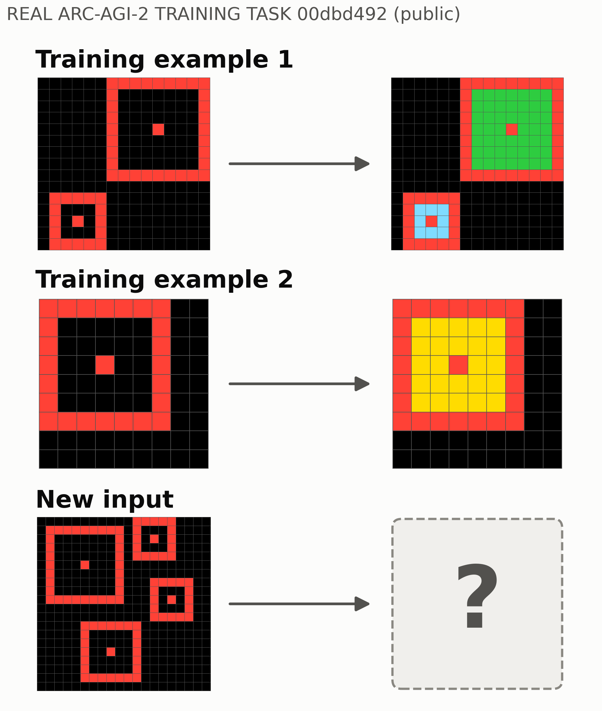
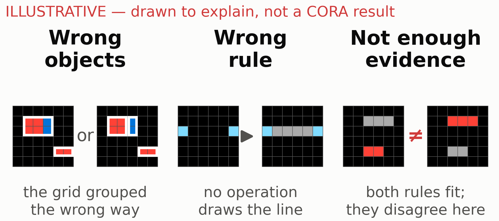
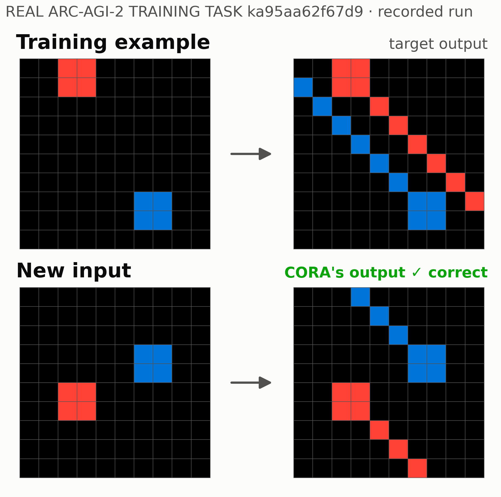
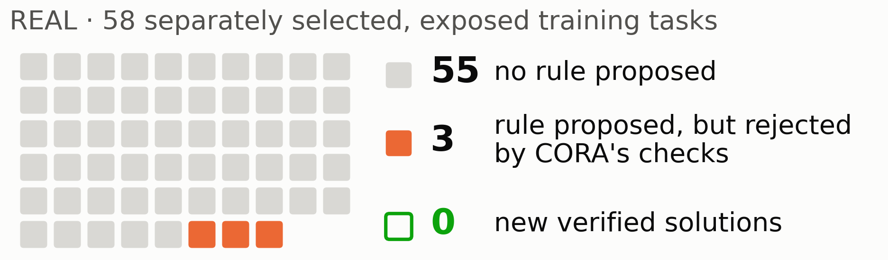
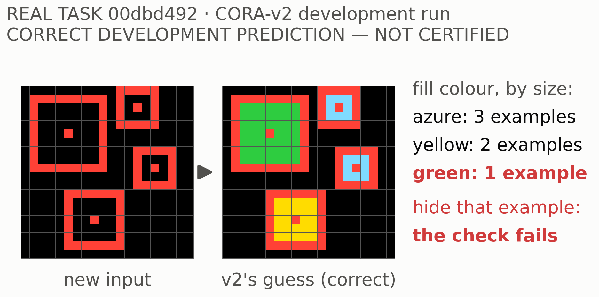

#+TITLE: LEARNING WHAT TO CHANGE
#+AUTHOR: Chimdi Walter Ndubuisi
#+LATEX_CLASS: summit-tikzposter
#+OPTIONS: toc:nil title:nil num:nil date:nil ^:nil author:t
# ---------------------------------------------------------------------------------------------------------------------
# SCIENCE-FIRST REVIEW POSTER (19 October 2026). The source of truth for poster_science_first_review.pdf.
# For collaborator review (Toni, Chris, Pierce) and the user's approval. NOT for print.
# Build:  sh scripts/build_summit_org.sh poster   (Org -> LaTeX -> PDF; see ORG_TO_PDF_README.md)
# Edit:   change text directly below. Each poster block is a #+BEGIN_posterblock ... #+END_posterblock special block; its
#         title is the {…} in the #+ATTR_LATEX line above it. Columns are the one-line #+LATEX: \column{…} commands.
#         Figures are Org links into figures/ (same folder). Diagrams are the TikZ export blocks.
# Visual truth: SOLID outline = implemented and tested; DASHED = proposed or not validated; GREY = context, not a
#         CORA component. Every number: records/CORA_SUMMIT_CLAIM_LEDGER_20261017.md (see
#         POSTER_SCIENCE_FIRST_CLAIM_AUDIT.md). Figures: figures/PROVENANCE.json. Size: A0 portrait, a REVIEW ASSUMPTION.
# ---------------------------------------------------------------------------------------------------------------------
#+LATEX_HEADER: \RequirePackage{fix-cm}
#+LATEX_HEADER: \usepackage[scaled]{helvet}\renewcommand{\familydefault}{\sfdefault}
#+LATEX_HEADER: \usepackage[T1]{fontenc}\usepackage{graphicx}\usepackage{amssymb}\usepackage{environ}\usepackage{enumitem}
#+LATEX_HEADER: \usetikzlibrary{positioning, arrows.meta, fit, calc, backgrounds}
#+LATEX_HEADER: \pdftrailerid{}\hyphenpenalty=10000\exhyphenpenalty=10000
#+LATEX_HEADER: \newcommand{\bodyfont}{\fontsize{30}{38}\selectfont\raggedright}
#+LATEX_HEADER: \newcommand{\secfont}{\fontsize{26}{32}\selectfont\raggedright}
#+LATEX_HEADER: \newcommand{\diagfont}{\fontsize{26}{31}\selectfont}
#+LATEX_HEADER: \newcommand{\diagsub}{\fontsize{22}{27}\selectfont}
#+LATEX_HEADER: \newcommand{\bignum}[1]{{\fontsize{120}{120}\selectfont\bfseries #1}}
#+LATEX_HEADER: \newcommand{\bt}[1]{{\fontsize{40}{48}\selectfont #1}}
#+LATEX_HEADER: \newcommand{\chip}[2]{{\fontsize{26}{30}\selectfont\color{#1}\,[#2]}}
#+LATEX_HEADER: \definecolor{ink}{HTML}{0B0B0B}\definecolor{ink2}{HTML}{52514E}\definecolor{accent}{HTML}{2A78D6}
#+LATEX_HEADER: \definecolor{warm}{HTML}{EB6834}\definecolor{good}{HTML}{0CA30C}\definecolor{neutral}{HTML}{F0EFEC}
#+LATEX_HEADER: \definecolor{critical}{HTML}{D03B3B}\definecolor{paper}{HTML}{FCFCFB}\definecolor{arcblue}{HTML}{0074D9}
#+LATEX_HEADER: \definecolor{arcred}{HTML}{FF4136}\definecolor{leaf}{HTML}{9CCC65}\definecolor{lesion}{HTML}{8D6E63}
#+LATEX_HEADER: \definecolor{band1}{HTML}{FDEBD3}\definecolor{band2}{HTML}{FADBD8}
#+LATEX_HEADER: \usetheme{Simple}\tikzposterlatexaffectionproofoff
#+LATEX_HEADER: \colorlet{backgroundcolor}{paper}\colorlet{framecolor}{paper}\colorlet{titlefgcolor}{ink}
#+LATEX_HEADER: \colorlet{titlebgcolor}{paper}\colorlet{blocktitlebgcolor}{paper}\colorlet{blocktitlefgcolor}{accent}
#+LATEX_HEADER: \colorlet{blockbodybgcolor}{paper}\colorlet{blockbodyfgcolor}{ink}
#+LATEX_HEADER: \newcommand{\postersubtitle}{From Scientific Observations to Executable Reasoning and Hypothesis Revision}
#+LATEX_HEADER: \newcommand{\posteraffil}{University of Missouri}
#+LATEX_HEADER: \newcommand{\posterstatus}{REVIEW DRAFT 19 October: for collaborator review, not for print}
#+LATEX_HEADER: \makeatletter\settitle{\centering\vbox{\color{titlefgcolor}{\bfseries\fontsize{100}{112}\selectfont \@title\par}\vspace*{0.2em}{\fontsize{50}{60}\selectfont \postersubtitle\par}\vspace*{0.25em}{\fontsize{36}{44}\selectfont\color{ink2} \@author\ \,$\cdot$\, \posteraffil \quad {\color{critical}\posterstatus}}}}\makeatother
#+LATEX_HEADER: \tikzset{stage/.style={rounded corners=8pt, draw=accent, line width=2.6pt, fill=white, align=center, font=\diagfont, inner sep=9pt},
#+LATEX_HEADER:   pstage/.style={stage, dashed, draw=ink2, dash pattern=on 12pt off 7pt},
#+LATEX_HEADER:   ctx/.style={rounded corners=8pt, draw=none, fill=neutral, align=center, font=\diagfont, inner sep=9pt},
#+LATEX_HEADER:   flow/.style={-{Latex[length=8mm,width=6mm]}, line width=2.8pt, draw=ink2},
#+LATEX_HEADER:   dflow/.style={flow, dashed, dash pattern=on 12pt off 7pt},
#+LATEX_HEADER:   lab/.style={font=\diagsub, text=ink2, align=center}}
#+LATEX_HEADER: \NewEnviron{posterblock}[1]{\block{#1}{\BODY}}

#+LATEX: \maketitle[width=0.97\linewidth, titletotopverticalspace=10mm, titletoblockverticalspace=6mm]

# ===================================================== 1. THE GENERAL SCIENTIFIC QUESTION, WITH A SMALL BIOLOGY MOTIVATION
#+ATTR_LATEX: :options {}
#+BEGIN_posterblock
#+LATEX: \begin{minipage}[c]{0.60\linewidth}\raggedright{\fontsize{56}{66}\selectfont\bfseries
How can a machine learn the objects, relationships and rules in unfamiliar data---and know what to reconsider when its
explanation is not enough?
#+LATEX: \par}\vspace{0.45em}{\fontsize{32}{40}\selectfont\color{ink2}
Biology illustrates the difficulty: measurements do not arrive with the correct entities, mechanisms or reasoning
rules already identified.
#+LATEX: \par}\end{minipage}\hfill\begin{minipage}[c]{0.37\linewidth}
#+BEGIN_EXPORT latex
\centering
\begin{tikzpicture}
  % ILLUSTRATIVE SCHEMATIC: a stylized leaf with lesion-like spots. Not a photograph and not data.
  \fill[leaf] (0,0) .. controls (3,3.3) and (11,3.3) .. (14,0) .. controls (11,-3.3) and (3,-3.3) .. (0,0);
  \draw[line width=2pt, black!45] (0,0) -- (14,0);
  \foreach \x/\y/\r in {2.2/0.8/0.42, 3.9/-1.0/0.55, 5.4/1.3/0.36, 6.9/-0.6/0.62, 8.6/0.9/0.46, 10.2/-1.2/0.4,
                        11.6/0.6/0.42, 4.6/0.2/0.28, 9.4/-0.1/0.3, 12.6/-0.4/0.26}
    \fill[lesion] (\x,\y) ellipse ({1.5*\r} and {\r});
  \node[font=\diagsub\bfseries, text=critical, anchor=south west] at (0,3.0) {ILLUSTRATIVE SCHEMATIC, not data};
  \node[lab, anchor=north] at (7,-2.9) {maize lesion-mimic pattern};
  \draw[flow] (14.6,0) -- (16.8,0);
  \node[font=\fontsize{110}{110}\selectfont\bfseries, text=ink2] at (19.0,0) {?};
  \node[anchor=north west, text width=24cm, align=left, font=\fontsize{30}{37}\selectfont] at (0,-4.4)
    {\textbf{What process could explain these patterns?}\\[0.2em]
     {\bfseries\color{critical}Observed pattern $\neq$ identified mechanism.}};
\end{tikzpicture}
#+END_EXPORT
#+LATEX: \end{minipage}
#+END_posterblock

# ===================================================== 2. THE BIG REASONING PIPELINE, WITH THE TWO BOTTLENECKS
#+ATTR_LATEX: :options {\bt{One reasoning loop}}
#+BEGIN_posterblock
#+BEGIN_EXPORT latex
\centering
\begin{tikzpicture}[node distance=2.1cm]
  \tikzset{main/.style={text width=8.3cm, minimum height=4.6cm}}
  % bottleneck bands (drawn first, behind the nodes)
  \fill[band1, rounded corners=14pt] (-16.4,-3.1) rectangle (6.4,4.1);
  \node[font=\fontsize{28}{33}\selectfont\bfseries, text=warm, anchor=south] at (-5.0,4.1)
    {BOTTLENECK 1 \,$\cdot$\, measured: CORA often cannot propose a usable rule};
  \fill[band2, rounded corners=14pt] (16.6,-12.2) rectangle (28.4,-5.6);
  \node[font=\fontsize{28}{33}\selectfont\bfseries, text=critical, anchor=west, text width=9.4cm, align=left]
    at (28.7,-8.9) {BOTTLENECK 2\\ unproven: can it learn which part to revise?};
  % the main path
  \node[ctx, main] (q) at (-32.5,0) {\textbf{Scientific question}\\[0.2em]{\diagsub what explains an observation?}};
  \node[ctx, main] (o) at (-21.5,0) {\textbf{Observations}\\[0.2em]{\diagsub images $\cdot$ measurements $\cdot$ ARC grids}};
  \node[stage, main] (f) at (-10.5,0) {\textbf{Find objects and relations}\\[0.2em]{\diagsub what counts as an object}};
  \node[stage, main] (p) at (0.5,0) {\textbf{Propose executable rules}\\[0.2em]{\diagsub explanations as runnable programs}};
  \node[stage, main] (e) at (11.5,0) {\textbf{Execute and test}\\[0.2em]{\diagsub on visible examples}};
  \node[stage, main] (s) at (22.5,0) {\textbf{Supported, or not?}\\[0.2em]{\diagsub rival rules fit, or a held-out example fails}};
  \node[stage, main] (v) at (33.5,0) {\textbf{Predict, then evaluate independently}};
  \foreach \a/\b in {q/o, o/f, f/p, p/e, e/s} \draw[flow] (\a) -- (\b);
  \draw[flow] (s) -- node[lab, above, font=\diagsub\bfseries] {yes} (v);
  % the revision loop
  \node[pstage, text width=9.0cm, minimum height=4.2cm] (r) at (22.5,-8.9)
    {\textbf{Choose what to revise}\\[0.2em]{\diagsub objects $\cdot$ rule $\cdot$ evidence $\cdot$ abstain}};
  \node[stage, text width=8.3cm, minimum height=4.2cm] (t) at (9.0,-8.9)
    {\textbf{Test the revision}\\[0.2em]{\diagsub keep or reject}};
  \draw[flow] (s) -- node[lab, left, text width=6.0cm, align=right] {no: incomplete, conflicting or fragile} (r);
  \draw[dflow] (r) -- (t);
  \draw[dflow] (t.north) -- node[lab, right, pos=0.45] {retry} (t.north |- p.south);
  % the proposed learned component, inside the loop
  \node[pstage, text width=10.6cm, minimum height=4.2cm] (l) at (-6.2,-8.9)
    {\textbf{Learned priors}\\[0.2em]{\diagsub Neural-CORA, proposed}};
  \draw[dflow] (l.north east) -- node[lab, left, pos=0.55] {proposals} (p.south west);
  \draw[dflow] (l.south) .. controls (-6.2,-14.4) and (22.5,-14.9) .. node[lab, below, pos=0.5] {what to revise} (r.south);
  \node[lab, font=\diagsub\itshape, anchor=south] at (22.5,2.45) {visible evidence only: no hidden answer};
\end{tikzpicture}
\par\vspace{0.4em}
#+END_EXPORT
#+LATEX: {\secfont\color{ink2}
Solid: implemented and tested. Dashed: proposed. Grey: context. A tested revision is not automatically a correct
explanation.
#+LATEX: \par}
#+END_posterblock

#+LATEX: \begin{columns}

# ===================================================== 3. COLUMN 1: ARC AS THE CONTROLLED TESTBED
#+LATEX: \column{0.333}
#+ATTR_LATEX: :options {\bt{ARC is our controlled testbed}}
#+BEGIN_posterblock
#+LATEX: \bodyfont
Few examples, a new input, one exact answer.

#+ATTR_LATEX: :width \linewidth :center nil

#+LATEX: {\secfont\color{ink2}
Rule: each frame's fill colour depends on its size.
#+LATEX: \par}
#+END_posterblock

#+ATTR_LATEX: :options {\bt{Why rules fail}}
#+BEGIN_posterblock
#+LATEX: \bodyfont
#+ATTR_LATEX: :width \linewidth :center nil

#+LATEX: {\secfont\color{ink2}
Memorization: fits the examples, fails the new input.
#+LATEX: \par}
#+END_posterblock

# ===================================================== 4. COLUMN 2: WHAT CORA DID, AND WHERE IT FAILED
#+LATEX: \column{0.333}
#+ATTR_LATEX: :options {\bt{Done: a rule CORA built}\chip{good}{DONE, NARROW}}
#+BEGIN_posterblock
#+LATEX: \bodyfont
#+ATTR_LATEX: :width \linewidth :center nil

#+LATEX: \textbf{Rule:} {\color{arcblue}\textbf{blue}} objects send a line up-left; {\color{arcred}\textbf{red}} ones, down-right.\par\vspace{0.3em}{\secfont
Rebuilt 3 of 3 times with one example hidden; correct on an exposed training task, not a competition solve. Also
found without the failure record.
#+LATEX: \par}
#+END_posterblock

#+ATTR_LATEX: :options {\bt{Where it fails}\chip{critical}{NEGATIVE}}
#+BEGIN_posterblock
#+LATEX: \bodyfont\centering{\color{critical}\bignum{0 / 58}}\par\vspace{0.1em}
new verified solutions from rule construction
#+LATEX: \par\vspace{0.2em}
#+ATTR_LATEX: :width \linewidth :center nil

#+LATEX: \raggedright{\secfont\color{ink2}
Every variant: 0; no wrong answers.
#+LATEX: \par}
#+END_posterblock

# ===================================================== 5. COLUMN 3: OBSERVABLE DOUBT, AND THE PROPOSED NEXT STEP
#+LATEX: \column{0.333}
#+ATTR_LATEX: :options {\bt{Visible doubt}\chip{warm}{DEVELOPMENT}}
#+BEGIN_posterblock
#+LATEX: \bodyfont
#+ATTR_LATEX: :width \linewidth :center nil

#+LATEX: {\secfont
One example decides the green fill, so CORA-v2 keeps its correct guess uncertified.
#+LATEX: \par}
#+END_posterblock

#+ATTR_LATEX: :options {\bt{Next: learning inside CORA}\chip{ink2}{PROPOSED}}
#+BEGIN_posterblock
#+BEGIN_EXPORT latex
\centering
\begin{tikzpicture}
  \node[pstage, text width=7.6cm] (a) at (0,0) {trained prior\\{\diagsub Qwen3-4B}};
  \node[stage, text width=7.6cm] (b) at (11.0,0) {CORA rules};
  \node[stage, text width=7.6cm] (c) at (11.0,-4.6) {run and check};
  \node[pstage, text width=7.6cm] (d) at (0,-4.6) {feedback};
  \node[stage, text width=7.6cm] (e) at (11.0,-8.8) {prediction};
  \draw[dflow] (a) -- (b); \draw[flow] (b) -- (c); \draw[dflow] (c) -- (d); \draw[dflow] (d) -- (a); \draw[flow] (c) -- (e);
\end{tikzpicture}
\par\vspace{0.3em}
#+END_EXPORT
#+LATEX: \bodyfont
A trained prior would only order CORA's own search. No result yet.

#+LATEX: \vspace{0.6em}{\secfont\color{ink2}
NVARC (published Qwen3-4B method), reproduced: 27.64% public. Native CORA and CORA with rule construction: 0.00% public.
#+LATEX: \par}
#+END_posterblock

#+LATEX: \end{columns}

# ===================================================== 6. THE LARGER AMBITION (one line) AND SOURCES
#+ATTR_LATEX: :options {}
#+BEGIN_posterblock
#+LATEX: {\fontsize{38}{48}\selectfont\bfseries\raggedright
If revision selection works on ARC, test the reasoning procedure---not ARC grid operations---on independently
validated biological questions. @@latex:{\color{critical}[UNTESTED]}@@
#+LATEX: \par}\vspace{0.4em}{\fontsize{22}{27}\selectfont\color{ink2}\raggedright
Prior work: Popper (Cropper & Morel 2021), DreamCoder (Ellis et al. 2021), LILO (Grand et al. 2024), Model Discovery
Agent (Murphy 2026); details in the explainer. Numbers: =records/CORA_SUMMIT_CLAIM_LEDGER_20261017.md=.
AI coding assistance used. Authorship pending collaborator review.
#+LATEX: \par}
#+END_posterblock
